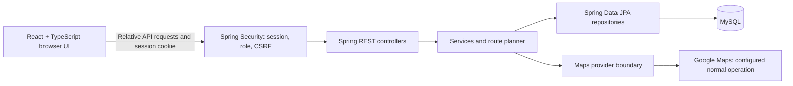

# Architecture and engineering tradeoffs

This master's dissertation/portfolio application prepares deliveries, assigns drivers, orders stops and supports driver-owned completion. It is demonstrated locally. This guide describes the implementation through merged PR #70 (`f3fb73f`), with links for deeper review.

## System at a glance

The Java 25/Spring Boot application packages the Vite build and serves its `/app/` entry points. During development, Vite on port 5174 proxies API requests to Spring on 8081. Controllers translate HTTP contracts; services own business operations; repositories own persistence queries. DTOs keep API responses separate from JPA entities. See [frontend packaging](REACT_FRONTEND.md), [Vite configuration](frontend/vite.config.ts) and [entry-point controller](src/main/java/com/mmu/schedulingapp/frontend/FrontendController.java).

## Identity and permissions

Spring Security authenticates persisted accounts into cookie sessions, applies CSRF protection to writes and enforces administrator versus driver access. Client route guards help navigation; server checks protect the data. [AccountSessionFilter](src/main/java/com/mmu/schedulingapp/security/AccountSessionFilter.java) checks current account state and authentication revision so changed/revoked access cannot rely solely on a stale session. Driver queries and updates enforce persisted account/assignment ownership. See [security configuration](src/main/java/com/mmu/schedulingapp/security/SecurityConfiguration.java), [driver service](src/main/java/com/mmu/schedulingapp/driver/DriverAssignmentService.java) and [session setup](SESSION_SETUP.md).

## Scheduling: three distinct decisions

1. **Select drivers.** The snapshot considers available operators without active routes, rejects an oversized candidate pool, and filters missing warehouse coordinates. If drivers outnumber deliveries, [DriverSelector](src/main/java/com/mmu/schedulingapp/service/autorouting/DriverSelector.java) greedily selects nearby warehouse/delivery pairs; otherwise all routable candidates participate.
2. **Allocate deliveries.** [DriverAllocator](src/main/java/com/mmu/schedulingapp/service/autorouting/DriverAllocator.java) uses nearest geographic pairs within stop-count quotas. Counts differ by at most one; lower operator IDs receive any extra quota. This balances counts, not vehicle load or working time.
3. **Order each route.** [RouteBuilder](src/main/java/com/mmu/schedulingapp/service/autorouting/RouteBuilder.java) greedily ranks candidates using priority, local great-circle distance and urgency at one captured time. Lower scores win; overdue work receives extra urgency weight. Equal scores use delivery ID. Existing sub-metre current-position groups use priority/urgency with distance zero. Only selected legs request provider estimates, cached by directed coordinates within the builder. Unavailable estimates fall back to labelled geographic distance with unknown duration; budget/deadline exceptions propagate. See [scoring](src/main/java/com/mmu/schedulingapp/service/autorouting/DeliveryScore.java), [allocation tradeoffs](GEOGRAPHIC_ALLOCATION.md) and [shared-location ordering](COLOCATED_DELIVERY_ORDERING.md).

## Why the transaction boundaries matter

[RouteService](src/main/java/com/mmu/schedulingapp/service/RouteService.java) coordinates [RoutePlanningTransactions](src/main/java/com/mmu/schedulingapp/service/RoutePlanningTransactions.java):

- **Snapshot:** read immutable planning inputs in a short read transaction.
- **Calculate:** rank, allocate and obtain travel estimates outside database transactions, avoiding a connection/assignment lock held while waiting for Maps.
- **Revalidate and commit:** lock the selected operators and deliveries in stable order, refresh related data under locks, reject changed inputs, verify complete coverage and save assignments/routes atomically. A later persistence failure rolls back the whole plan.

The commit marks deliveries IN_PROGRESS and operators ON_DELIVERY. [DeliveryLifecycleService](src/main/java/com/mmu/schedulingapp/service/DeliveryLifecycleService.java) completes a route once all its stops are COMPLETED/CANCELLED and releases its operator when no other active route remains. Active/history deletion guards preserve work; referenced-recipient deletion returns a clear conflict while retaining the FK safeguard. See [planning concurrency](ROUTE_PLANNING_TRANSACTIONS.md), [lifecycle](DELIVERY_LIFECYCLE.md) and [recipient deletion](RECIPIENT_DELETION.md).

## Decisions and limits worth explaining

| Decision | Why it fits this project | Practical limit |
| --- | --- | --- |
| Spring MVC/JPA/MySQL in one application | Clear service boundaries and relational transactions suit the existing workflow. | No distributed-service architecture or large-scale throughput claim. |
| React + TypeScript + Vite | Interactive browser workflows with typed API integration; Spring remains the backend. | TypeScript alone does not validate received JSON or enforce permissions. |
| Local geographic greedy routing | Repeatable, explainable selection with fewer paid provider requests. | Road barriers, traffic and global route optimality are not captured by candidate distance. |
| Count-balanced allocation | A clear rule that is easy to demonstrate and test. | Capacity units, delivery load and overload policy are undefined; `maxCapacity` is not enforced by routing. |
| Explicit hypothetical window assessment | Shows waiting/lateness using saved travel estimates without changing assignments or calling Maps again. | Does not reject generation or guarantee feasible schedules; missing duration propagates unknown. |
| Bounded synchronous planning | Defaults cap planning at 50 deliveries, 500 operator candidates, 100 provider attempts and two concurrent planning operations, with a ten-second planning budget. | Bounds are configurable; cooperative deadline checks and transport limits are not a universal HTTP response-time guarantee. |

[Window assessment](ROUTE_WINDOW_ASSESSMENT_API.md) requires an explicit local departure timestamp and uniform whole-second service duration. Windows constrain service start, inclusive of closing time; service may finish later. It uses original delivery dates and has no timezone/DST model. It assesses the saved route, including terminal stops, rather than actual driver arrival history. See [assessor](DELIVERY_WINDOW_ASSESSMENT.md) and [planning bounds](MAPS_REQUEST_BOUNDS.md).

Modern directories are bounded, while some legacy lists and response differences remain. Entity equality/builder defaults remain maintenance opportunities. [BACKEND_STATUS_REVIEW.md](BACKEND_STATUS_REVIEW.md) records these limits; this guide does not declare every audit item fixed or the application production-ready.

## Demonstration and evidence

With Java 25 selected, Docker running and Python 3 available, run `./scripts/run-backend-demo.sh`. The short-lived walkthrough uses a disposable MySQL database and real authenticated HTTP APIs. Fixture setup seeds fictional data internally. Its test-only provider explicitly simulates travel: it neither validates live Google responses nor requires a Maps key. Initial build/image downloads may need internet. Existing development data and ports are untouched. See [PORTFOLIO_BACKEND_DEMO.md](PORTFOLIO_BACKEND_DEMO.md).

For an interview, show the nearby higher-ID driver's selection, compare early/late departure assessments without extra provider calls, then show completion releasing the driver and retaining history. Explain the snapshot/commit race test as evidence for the transaction design.

[CI.md](CI.md) describes unit, HTTP, H2, disposable MySQL, component, tooling and browser checks. The PR #70 local run passed 618 backend tests, 434 frontend tests, twelve MySQL suites, 57 tooling tests and the required browser checks. Those are prior runtime results, not a newly executed run for this documentation branch, complete coverage, or hosted GitHub verification. See [race tests](src/test/java/com/mmu/schedulingapp/account/DriverMySqlIntegrationTest.java) and [deletion regressions](src/test/java/com/mmu/schedulingapp/account/RecipientDeletionMySqlTest.java).

## Completion of this improvement pass

The selected recipient-deletion fix is merged in PR #70. This guide closes the remaining explanation task. Keep the existing system and demonstrate it; further frontend changes, hosting and production recovery/monitoring are outside the current objective. Reopen implementation for a concrete reproduced defect or an explicitly changed goal. The [roadmap](IMPROVEMENT_ROADMAP.md#current-next-steps) preserves the original plans as historical reference.
