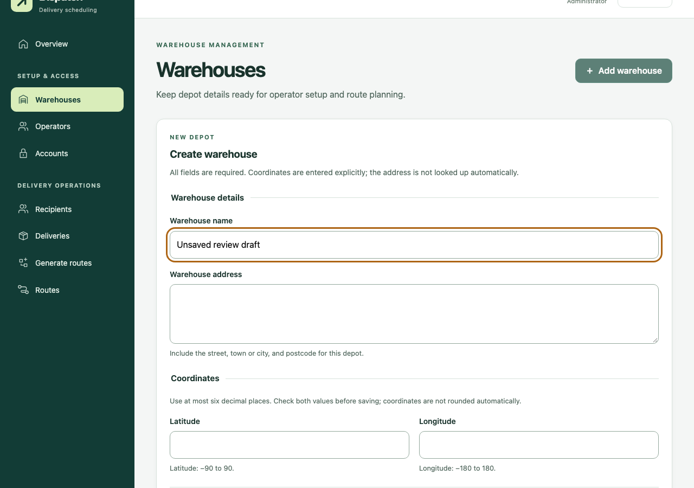
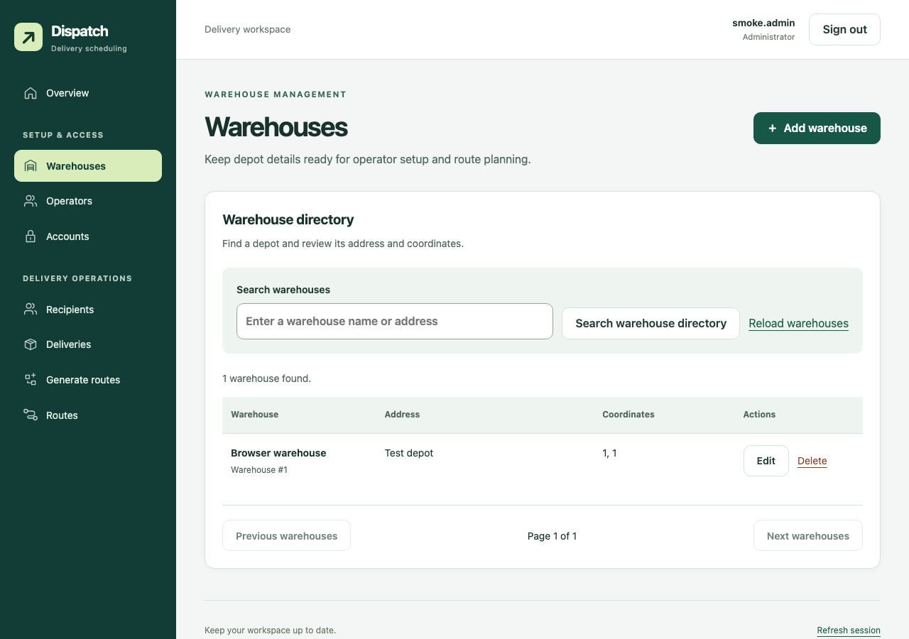
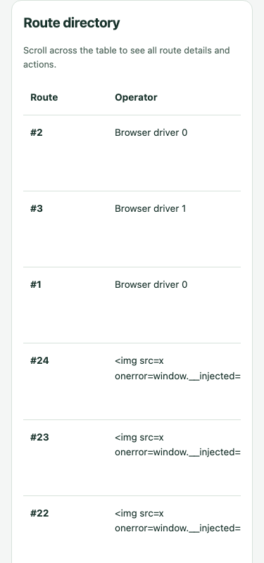
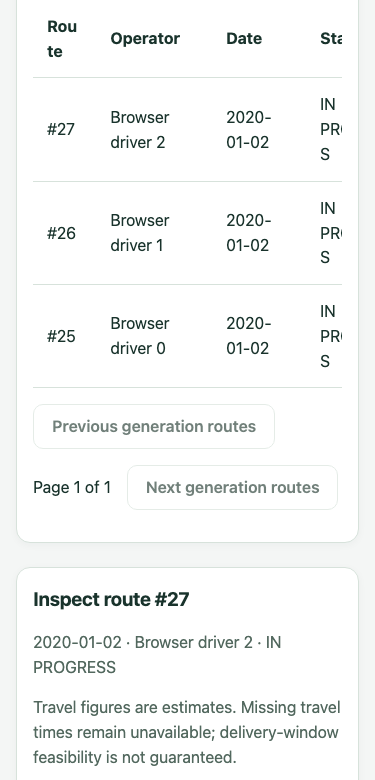
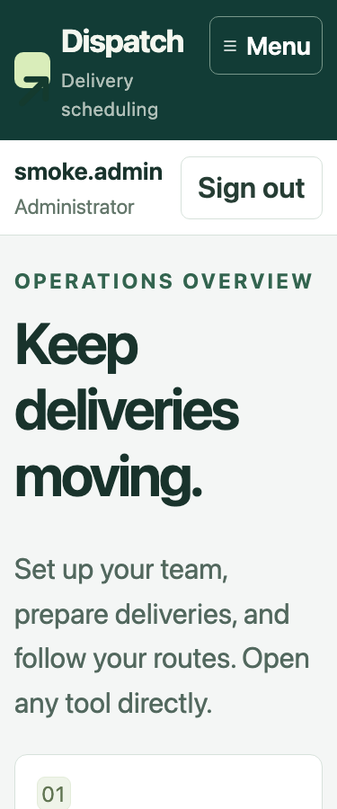

# Frontend consistency, accessibility and recovery review

Reviewed application revision: `36b71793e1502618a58bd8d78cfad146fa2bcced` (merged Accounts interface). Date: 2026-10-14. This branch adds review evidence and observational browser tooling; it does not change application behavior or remediate the findings.

React + TypeScript + Vite remain appropriate for this authenticated workspace. The verified problems below can be addressed within the existing stack. This is a scoped Chromium/source review, not a WCAG certification or a production-readiness sign-off.

## Prioritised findings

P1: next reliability fix. P2: important accessibility/recovery or usability work. P3: polish or a design-policy decision. Browser observations, static gaps and recommendations are distinguished below.

| ID | Priority | Finding | Evidence |
|---|---|---|---|
| FR-01 | P1 | A successful background session check discards an unsaved editor | Browser reproduction + source |
| FR-02 | P2 | Desktop page navigation leaves focus in the sidebar | Browser reproduction + source |
| FR-03 | P2 | Every reviewed page has the same generic document title | Browser observations + source |
| FR-04 | P2 | Three normal text styles fall below 4.5:1 contrast | Settled computed colours + source |
| FR-05 | P2 | No application error boundary for unexpected render failures | Verified static structural gap |
| FR-06 | P2 | Remaining route directories require horizontal scrolling on phones | Measured usability opportunity; not automatically a WCAG failure |
| FR-07 | P3 | Route generation initially focuses the committing action | Browser observation; confirmation-policy consistency opportunity |
| FR-08 | P3 | Decorative brand arrow outgrows its tile at enlarged text size | Visual observation + source |

### FR-01 — Session refresh discards unsaved work

**Reproduce:** open Warehouses, select Add warehouse, enter an unsaved name, then dispatch a window focus event. After `/api/auth/me` returns 200 and rendering settles, the editor is absent. No warehouse write is submitted by this probe. The same administrator session remains valid.

[App.tsx:48](frontend/src/App.tsx#L48) switches the entire workspace into loading; [App.tsx:69](frontend/src/App.tsx#L69) then replaces it with the entry screen. Child form state is unmounted. Window focus and visibility changes invoke this refresh. This is more than a visual flicker: users can lose work when returning from another window. Loss of child recovery context is also a source-level consequence of the same unmount; it was not a separate browser experiment.

**Next change:** revalidate an existing session without unmounting a valid workspace, with explicit handling for identity/role changes, expiry and failed checks. Keep initial loading separate. Do not persist passwords, automatically replay writes or retain protected content after revoked access.

**Acceptance:** a draft survives a successful check for the same identity; 401/mandatory password change removes protected content; identity/role changes cannot retain another user's view; pending/uncertain-write guards survive revalidation. Add component and real-browser regressions before pushing that fix.

### FR-02 — Desktop navigation does not move focus into the new page

After clicking Recipients on desktop, the active element remains an anchor with `href=/app/admin/recipients`, rather than main content or the page heading. [WorkspaceNavigation.tsx:53](frontend/src/WorkspaceNavigation.tsx#L53) only schedules main-content focus for mobile navigation.

**Next change:** agree and implement consistent post-navigation focus for deliberate internal page changes. Cover desktop, mobile and back/forward navigation without moving focus on routine data refreshes or stealing modal focus. This observation alone is not a complete screen-reader conformance judgment.

### FR-03 — Generic page titles

All observed login, password setup, administrator and driver snapshots use `Delivery workspace`. [index.html:3](frontend/index.html#L3) sets the static title; there is no route-title update in the frontend source.

**Next change:** use concise route-specific titles, for example `Accounts · Dispatch` and `Assigned routes · Dispatch`, including restricted/not-found states. Avoid personal details and credentials in titles. Test direct links and navigation. This is a verified navigation usability gap, not a standalone claim of WCAG nonconformance.

### FR-04 — Normal text contrast

Settled foreground/background colours produce these ratios. Disabled controls, transparent/composited backgrounds, gradients and opacity-dependent elements are excluded from this limited measurement.

| Style | Colours | Text size | Ratio | Source |
|---|---|---|---|---|
| Login footer | `#73867a` / `#f8f9f5` | 11px | 3.664:1 | [styles.css:483](frontend/src/styles.css#L483) |
| Workspace label | `#6b7b73` / `#ffffff` | 13.44px | 4.462:1 | [styles.css:155](frontend/src/styles.css#L155) |
| Session footer text | `#6a796b` / `#f4f6f5` | 12px | 4.243:1 | [styles.css:258](frontend/src/styles.css#L258) |

These are ordinary visible text, not large text. W3C's [Contrast Minimum guidance](https://www.w3.org/WAI/WCAG22/Understanding/contrast-minimum.html) specifies 4.5:1 for normal text and cautions against rounding a failing ratio up to the threshold. This finding applies to these measured styles, not every colour or state in the application.

**Next change:** use a darker shared muted-text token and verify both the affected surfaces and interactive states. Prefer margin above the threshold. Do not treat disabled-control contrast or decorative logo colours as the same failure. The reporter settles the sidebar transition before measuring; an initial transition-frame candidate was excluded from the final review.

### FR-05 — Unexpected rendering failures lack a recovery boundary

[main.tsx:9](frontend/src/main.tsx#L9) mounts the router directly. No ErrorBoundary, `componentDidCatch` or `getDerivedStateFromError` exists in the frontend. This is a verified structural gap; no rendering crash was injected into the browser journey.

The [React error-boundary documentation](https://react.dev/reference/react/Component#catching-rendering-errors-with-an-error-boundary) describes a fallback for child rendering failures. An application boundary could provide a safe message and explicit recovery instead of losing the view. It is separate from the existing handled API failures; boundaries do not catch every event-handler or asynchronous error.

**Next change:** add a tested, nonsensitive fallback for render failures. Do not display raw exceptions, retain credentials in diagnostic output or retry mutations automatically. Test a deliberate child render exception and explicit recovery.

### FR-06 — Route directories retain a different mobile pattern

At a 375px viewport, the administrator route region has a 309px visible width and 647px scroll width; route generation has 309px visible width and 650px scroll width. [AdminRoutes.tsx:98](frontend/src/AdminRoutes.tsx#L98) and [RouteGeneration.tsx:146](frontend/src/RouteGeneration.tsx#L146) retain horizontal tables, unlike the modernised management cards. The page itself fits the viewport.

This is a verified consistency/usability opportunity. W3C's [Reflow guidance](https://www.w3.org/WAI/WCAG22/Understanding/reflow.html) permits two-dimensional scrolling for qualifying data tables; internal table overflow alone is not a proven WCAG failure.

**Next change:** modernise route summaries for narrow screens while retaining IDs, date/operator/status/progress, selected-route context, pagination and recovery across all statuses. Keep semantic single-record rendering and targeted keyboard tests.

### FR-07 — Confirmation-focus policy differs

[RouteGeneration.tsx:57](frontend/src/RouteGeneration.tsx#L57) opens the native dialog without explicitly selecting its safe action. The confirmation snapshot records focus on its first button, Confirm generation and assignment ([RouteGeneration.tsx:126](frontend/src/RouteGeneration.tsx#L126)). Warehouse/operator delete dialogs now initially focus Keep.

**Recommendation:** agree whether high-impact confirmations should consistently focus the noncommitting action. This is a design-policy opportunity, not a claimed WCAG violation or an absence of confirmation. If changed, retain explicit assignment warnings and test Enter, Escape and return focus without adding another generation request.

### FR-08 — Enlarged text exposes decorative branding polish

At a 375px viewport with root text size changed to 200%, the arrow extends outside its fixed tile. [styles.css:99](frontend/src/styles.css#L99) uses a 40px tile and a `1.7rem` glyph. The page remains within the viewport and primary content remains readable.

**Recommendation:** use a bounded icon size or scalable tile and verify enlarged text again. This is decorative polish; the test uses CSS text enlargement, not native browser zoom, and does not establish full zoom conformance.

## What already works in the exercised paths

- Management directories use semantic single-record cards at narrow widths, and long/HTML-looking test values render as text.
- Mobile menu disclosure, Escape, focus return and active-page state work in the browser journey.
- Assigned operator fields remain locked; account handoff and history/deletion guards work.
- API read failures, timeouts, stale records and uncertain writes have explicit recovery; no automatic write replay is introduced.
- Administrator passwords and temporary credentials retain clearing/one-time handling. Review metadata excludes the disposable temporary credential; screenshots mask password and temporary-password fields.
- Login/password setup and role-restricted views retain their existing regressions.

These observations cover exercised cases, not all possible combinations or production conditions.

## Evidence and reproduction

Run the existing `./scripts/run-ci.sh` with the documented pinned toolchain, browser dependencies and disposable MySQL runtime. [frontend-review.cjs](scripts/frontend-review.cjs) instruments the existing Chromium journey and writes `.ci-artifacts/browser/frontend-review.json`. [test-session-browser.cjs](scripts/test-session-browser.cjs) contains the focus/session/text-size probes. They are observations rather than assertions that defects must remain; future fixes can change the evidence without intentionally preserving a bug.

[Committed evidence](docs/frontend-review/evidence.json) contains locations, computed colours, sizes, titles and focus metadata, not form values or account/credential text. Screenshots use disposable test records and may show deliberately HTML-looking inert test names. Normal and failure screenshots mask sensitive inputs. Browser/source evidence is tied to the reviewed revision above; re-run after fixes rather than treating these findings as permanently current.

The existing journey exercises desktop and 320/375/768px layouts, selected dialogs, session expiry, errors and long test values. This review adds one 200% CSS-text observation. It does not include a complete screen-reader exercise, native 200/400% zoom testing across all screens, Firefox/WebKit/device acceptance, an exhaustive accessibility scanner, production latency/load testing or staging HTTPS/session acceptance. Placeholder, pseudo-element, focus-indicator and composited-colour contrast require separate checks. GitHub-hosted CI and branch enforcement remain unverified/blocked as previously documented.

## Focused implementation sequence

1. Fix FR-01 session revalidation/draft preservation in its own tested branch.
2. Address FR-02/FR-03 navigation focus and page titles with direct-link/back-forward coverage.
3. Fix FR-04 contrast and FR-08 bounded-branding polish with settled-state/text-size verification.
4. Add FR-05 render-error recovery with explicit, nonsensitive fallback tests.
5. Modernise FR-06 administrator route summaries, then route-generation review, in separate contract-preserving PRs.
6. Agree FR-07 confirmation focus and complete manual assistive-technology, native zoom and cross-browser acceptance.

Keep React, TypeScript and Vite. A technology replacement is not needed for these findings. Production approval still requires the operational gates in the main roadmap.

## Validation of this review branch

The full local CI script passed: 538 backend tests, 399 frontend tests, 10 disposable MySQL suites and 57 Python tooling tests, plus the Chromium journey and packaged-application checks. Dependency scanning reported zero matches across 392 package/version pairs. Secret scanning passed with the two previously acknowledged historical Maps-key locations.

After adding the final table screenshots, a targeted Maven verification passed all 21 application smoke tests, the Chromium journey and 399 frontend tests. The completed evidence contains 46 snapshots across 11 application paths. These are local results; hosted GitHub Actions and production acceptance were not verified.
