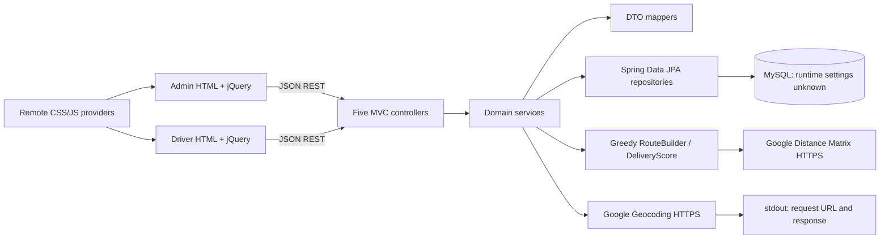

# Project audit

**Audit date:** 12 October 2026 (Europe/London)\
**Repository:** delivery-scheduling-system\
**Reviewed revision:** 98dba9eac39c453ae9b29b8a70f16e4d16770cb0, initially clean working tree\
**Mode:** audit only; no application-source edits, database changes, branches, commits, pull requests or pushes.

**Implementation plan:** [IMPROVEMENT_ROADMAP.md](IMPROVEMENT_ROADMAP.md)

> Historical baseline: findings below describe revision `98dba9e` on 12 October 2026. Subsequent merged fixes and remaining work are tracked in `IMPROVEMENT_ROADMAP.md`; this document is not a fresh scan of the current application.

## 1. Executive summary

This application manages warehouses, delivery operators, recipients, deliveries and routes. Administrators create recipients/deliveries and generate routes; drivers view an assigned route and complete or cancel deliveries. Route generation divides due pending deliveries across available operators and greedily orders each driver's stops using priority, deadline urgency and Google road distance. Recipient creation uses Google geocoding.

**Production readiness: not ready for deployment with real operational or personal data.** The foundation is understandable and recoverable, but the application has no source-established authentication/authorization, exposes a Maps credential, renders stored names as HTML, breaks validated operator creation, and does not close the route/driver lifecycle. Route deletion can turn completed deliveries back into pending work. These are functional and control failures, not cosmetic version-age complaints.

There is no reason to rewrite the application. Java 21, Spring MVC, JPA/MySQL, Maven, Bootstrap and a small JavaScript/jQuery frontend are proportionate to its present scope. Constructor injection, separate DTOs/mappers/services/repositories, persisted route order, HTTPS provider destinations, URL-encoded request parameters, transactions on most writes, safe text insertion in the recipient modal, and a per-builder leg cache are useful strengths. The primary architectural weakness is that route planning mixes external I/O, mutable entity scoring and database state changes inside one transaction without concurrency control.

The register contains **49 items: 18 High, 28 Medium and 3 Low; 37 confirmed issues, 7 likely issues requiring verification and 5 improvement opportunities.** No Critical vulnerability is asserted: public deployment exposure, credential validity and real data sensitivity are unknown. High findings remain release blockers. Severity reflects this application, not a generic library advisory score.

### Scope and evidence limits

All **56 tracked files** were inspected: 43 Java files, two HTML pages, two JavaScript files, API example, POM, Maven wrapper/configuration, Git ignore/attributes and two IDE metadata exports. The Java/frontend application source is approximately 2,943 lines. The remaining local binary .DS_Store and Git internals/history were not audited; they are not application implementation. Source coverage does not imply tested runtime coverage.

No src/test tree, migrations, README, CI workflows, Docker/deployment manifests, SECURITY.md or local application.properties exists in the supplied tree. The ignored configuration is absent locally, so no actual MySQL schema/server settings, credentials, deployment proxy/TLS, cloud resources, external backup policy or provider key restrictions were reviewed. There was no production database connection, migration, Google API call, credential validation or destructive endpoint invocation.

UI assessment is based on the HTML, JS, Bootstrap classes and workflow contracts. No live rendered browser, screen-reader/contrast measurement, screenshot comparison, browser performance trace or mobile device run was completed. Visual suggestions are recommendations, not invented observations about pixel rendering. Dependency checks used the actual packaged library versions and selected current official advisories, not a complete automated vulnerability scan.

## 2. Project architecture

### Technologies and layout

| Area | Current implementation | Assessment |
|---|---|---|
| Runtime/build | Java 21, Maven wrapper 3.9.10; local Maven 3.9.11 used for verification | Keep; explicitly pin runtime/toolchain and annotation processing |
| Backend | Spring Boot 3.5.0 / MVC / Jakarta Validation | Keep the framework; update to a supported maintenance path |
| Persistence | Spring Data JPA, Hibernate 6.6.15.Final, MySQL Connector/J 9.2.0, HikariCP 6.3.0 | Keep; server version and deployed DDL unknown |
| API serialization | Jackson 2.19.0; Gson 2.10.1 for distance parsing | Jackson already suffices; consolidation is optional maintenance |
| Generated code | Lombok 1.18.30 | Keep if useful, align compiler/version and exclude from runtime JAR |
| Frontend | Static HTML, jQuery 3.7.1, Bootstrap 5.3.0 / admin and 5.3.3/driver, Flatpickr, FontAwesome kit | Small page architecture remains appropriate; fix contracts/rendering/assets |
| External service | Google Geocoding and Distance Matrix endpoints | Retain provider integration behind a testable client; assess Legacy API migration |

Backend lives in src/main/java/com/mmu/schedulingapp; frontend in src/main/resources/static/html and static/js. The application serves both pages through Spring Boot static resource handling. There is no separate SPA, frontend build, token store, user-account model or authentication session implementation.

Current browser API destinations are literal localhost:8080; this diagram describes intended component interaction, not a verified deployed topology. No identity boundary is enforced in the checked-in controllers.

### Entities and relationships

Warehouse has many Operators; Operator optionally references a Warehouse. Delivery requires a Recipient and optionally references an Operator. Route requires an Operator and owns an ordered list of Deliveries through route_deliveries with delivery_order. Recipient/warehouse coordinates use decimal(9,6)-style JPA mappings. Status/priority enums use strings. Operator email is declared unique; warehouse name is not. Entity IDs are generated integers.

Delivery.operator and Route.operator/route membership encode assignment in more than one place, so planning/status/deletion must preserve agreement. The deployed join-table uniqueness, foreign keys, indexes, SQL check constraints and migration history cannot be established from annotations alone.

### Complete endpoint inventory

All paths below are relative to **/api/v1/scheduling-app**. Controllers are the authoritative implementation; all currently lack application-owned identity checks.

| Resource/path | Methods | Responsibility / current response behavior |
|---|---|---|
| /warehouses | GET, POST | List all (204 if empty), create (201) |
| /warehouses/{id} | GET, PUT, DELETE | Read, replace, delete; 404 on missing |
| /operators | GET, POST | List all (204 if empty), create; create hits enum validation defect |
| /operators/{id} | GET, PUT, PATCH, DELETE | Read/replace/partial update/delete; PUT validates, PATCH largely bypasses validation |
| /recipients | GET, POST | List all (204 if empty); create after external geocoding |
| /recipients/{id} | GET, PUT, DELETE | Read/update/delete recipient |
| /recipients/recipients?ids=1,2 | GET | Actual batch recipient endpoint; frontend uses a different URL |
| /deliveries | GET, POST | List all (204 if empty); create a pending delivery |
| /deliveries/{id} | GET, PUT, PATCH, DELETE | Read; replace pending only; change status; delete |
| /routes | GET, POST, DELETE | List all; generate across available drivers (201 with routes and processingTimeMs); bulk delete/reset |
| /routes/{id} | GET, DELETE | Read route; delete/reset its deliveries and operator |
| /routes/operator/{operatorId} | GET | Routes for a supplied driver ID; no caller ownership or active/date filter |

API versioning (/v1) already exists. Standard resource naming and CRUD methods are broadly reasonable; no wholesale redesign or hypermedia requirement is justified. Main API fixes concern authorization, validation, response consistency, pagination and workflow semantics.

### End-to-end workflow traces

1. **Recipient create:** admin form -> POST recipients -> validated request -> synchronous Google geocode -> mutate DTO with coordinates -> mapper -> repository save -> 201 -> refresh all recipient options. Failure categories are collapsed to no coordinates; request URL logs the key/address.
2. **Delivery create:** required operator/recipient selects -> POST deliveries -> recipient lookup, optional operator lookup (unknown supplied ID becomes null) -> pending delivery persisted. Route generation later overwrites the operator selected here.
3. **Route planning:** date-only form -> POST routes -> pending deliveries scheduled <= chosen date, plus AVAILABLE operators -> even-count sublists -> greedy score/Maps lookups -> persisted ordered routes -> deliveries IN_PROGRESS, operators ON_DELIVERY. No atomic claim or capacity/window feasibility check.
4. **Driver execution:** GET all routes -> select ID1 or first route -> render summaries -> preload recipients through mismatched batch URL -> PATCH delivery completion/cancellation -> delivery alone saved. Route remains IN_PROGRESS and driver ON_DELIVERY.
5. **Route delete:** individual/bulk delete -> all included deliveries become PENDING, assignments/metrics cleared -> driver AVAILABLE -> route removed. This affects terminal work too and is not a safe substitute for route completion.

## 3. Backend findings

The service/repository split and constructor injection should be preserved. Most controllers are compact and DTOs avoid direct entity serialization. Focus changes on explicit domain transitions, validated contracts, provider boundaries and transaction scope.

**Release blockers:** BE-01 (enum validation), BE-03/04/05 (lifecycle/history), BE-07 (routable driver prerequisites), BE-08 (assignment contract), BE-10 (window feasibility), BE-11 (address/coordinate updates). **Verification required:** BE-06 concurrent claiming and BE-14 create-ID merge behavior need disposable-MySQL integration tests. BE-02/12/13/15/16/17/18 describe validation, errors and provider/heuristic improvements. Each item below includes its concrete source and acceptance check.

Do not add generic service interfaces, repositories wrapping Spring Data, CQRS, event sourcing or microservices. A small injected Maps client, explicit transition operation and tested planning function provide clearer boundaries without increasing operational complexity.

## 4. Frontend findings

There are only two pages and 407 lines of JS. Component framework/state-store adoption is not required. Keep the existing frontend and extract a small API helper, consistent text-safe rendering helpers and shared form/error behavior. ES modules or JSDoc can improve organization/type hints; TypeScript becomes worthwhile only when the UI grows enough to justify its build step.

FE-01/02/03/04 are real integration defects, FE-05 is a modal race and FE-06 addresses reproducible assets. UX-01/02/03/04 identify specific responsive, accessible and interaction improvements; UX-05 completes existing admin tasks. Script execution order is currently workable: admin ready callbacks run after later Flatpickr loads, and Bootstrap is available before normal modal interaction. No confirmed load-order bug is invented.

## 5. Full-stack integration findings

The strongest contract failures are localhost destinations, wrong batch URL, empty204/forEach mismatch, operator-selection overwrite, hardcoded identity, incomplete route completion and recipient coordinate updates. Route creation's processingTimeMs wrapper matches admin usage; RouteResponseDTO summaries use status while DeliveryResponseDTO uses deliveryStatus, and the driver code handles both deliberately. That field difference is an inconsistency worth documenting, not a currently broken patch contract.

Backend-only warehouse/operator management and update/delete operations are incomplete frontend workflows, rather than missing backend support. The driver route summary omits time windows/instructions even though the delivery model already stores them. There is no basis to demand new tracking/maps/chat/payment features.

## 6. Security findings

Source review independently validated missing access control, stored XSS, hardcoded/logged credentials and unbounded provider work. SEC-01–05 are detailed in the register. Security scan severity is conditional on actual exposure and provider settings. No leaked credential was used or included in this report.

No source-supported dynamic SQL injection, arbitrary-host SSRF, shell execution, unsafe Java native deserialization, path traversal, file upload or token-storage vulnerability was found. Spring Data derived queries bind parameters; Google hosts are fixed HTTPS endpoints. JSON DTO deserialization is not evidence of native-deserialization execution. Absence of passwords/tokens means password hashing/storage and JWT expiry cannot be meaningfully evaluated today.

Wildcard CORS overlaps the missing-authorization control and is not claimed as a separate credentialed-CORS exploit: allowCredentials is not enabled. CSRF protection becomes necessary with the recommended cookie session; the current API already accepts anonymous direct calls. Add no bespoke cryptography or homemade token system.

## 7. Database findings

DB-01–07 and BE-06 identify schema reproducibility, constraints, lookup uniqueness, deletion policies, query loading, entity equality and builder defaults. Keep MySQL/JPA. Hikari pooling is already included through the JDBC starter; no 'missing connection pool' defect is asserted. Actual pool limits/TLS/grants/backup guarantees require runtime configuration evidence.

Suggested indexes to evaluate in migration/EXPLAIN tests include deliveries(status, scheduled_date), routes(operator_id, scheduled_date/status as dictated by queries), and appropriate join order/access indexes. Foreign-key indexes may already be created by MySQL, so inspect real DDL before duplicating them. No SQL counts, execution plans or existing database size were measured.

## 8. Performance findings

The main source-derived risk is route planning: for n distinct stops on one driver, approximately n(n+1)/2 different origin/destination requests are possible, including warehouse-origin candidates. At 100 stops this is 5,050 provider calls, not a measured production run. Duplicate coordinates/cache reduce this. External calls and persisted entity mutations occur in one long transaction, while cache memory is quadratic within each builder.

PERF-01 and DB-05 cover unbounded data/DOM and likely N+1 loads. FE-02 accidentally downloads all recipients and FE-05 can duplicate requests. Fonts/CDN assets and blocking scripts are smaller opportunities; no bundle report exists, and this frontend has no large application bundle to split. Avoid Redis, virtualized tables, aggressive memoization or a new queue until bounded endpoints/client planning and benchmarks show need.

## 9. Testing and validation findings

| Check | Actual result | Scope/limitation |
|---|---|---|
| Initial/final source review | All 56 tracked files inspected | Excludes Git history/internal metadata and local .DS_Store binary |
| node --check admin.js and operators.js | Both exit0 | Syntax only; not DOM, accessibility or end-to-end behavior |
| Offline Maven verify using host Java 25 | Failed with missing generated builder/getter symbols | Shows implicit annotation processor/toolchain issue; not proof Java 21 build is broken |
| Offline Maven verify using declared Java 21 (Oracle 21.0.3) | BUILD SUCCESS; executable JAR packaged | Maven 3.9.11 from local cache, not wrapper 3.9.10; no network/dependency downloads |
| Maven test phase | No tests to run | There is no existing backend suite; successful verify does not mean tests passed |
| Compiler warnings | Builder initializer defaults ignored; URL constructor deprecated | Current mappers explicitly initialize statuses/createdAt |
| Local Hibernate Validator probe | UnexpectedTypeException HV000030 for enum@NotBlank | No web server or database needed |
| Local mocked service probes | COMPLETED reopened to IN_PROGRESS; completed delivery leaves driver ON_DELIVERY; completed-route delete resets delivery PENDING | Uses actual compiled service code with mocked repositories; no database writes |
| Initial Mockito probe | Agent self-attachment unavailable | Retried with explicit local Mockito startup javaagent; service probes then completed |
| Dependency versions | Verified actual JAR: Spring MVC6.2.7, Tomcat 10.1.41, MySQL 9.2.0, Gson 2.10.1, Lombok 1.18.30, Hikari 6.3.0 | Selected official advisories reviewed; no complete automated SCA scan |
| Linters/static analysis | Source audit and compiler/syntax checks only | No configured Java/JS linter, Checkstyle/SpotBugs/ESLint or installed OWASP scanner found |
| Application/API/browser startup | Not attempted against external services | Missing local datasource config; avoided startup schema changes/provider credentials |

All builds/probes ran from a disposable temporary repository copy. The application repository stayed unchanged. Future tests should prioritize transition matrices, route/driver completion, immutable history, ownership, XSS-safe rendering, provider deadlines, batch/empty response contracts, location updates, constraints and concurrent planning. Use disposable MySQL for behavior that mocks cannot establish, and mocked Google responses for deterministic planning/failure cases.

## 10. UI/UX improvement recommendations

Preserve Bootstrap and introduce a compact visual system: consistent page headings/navigation, one spacing scale, restrained status colors, readable typography, clear form groups and one button hierarchy. Replace colorful create-card emphasis with task hierarchy: delivery queue and route status first, create/edit actions next. Show route results and warnings with a useful next action; processing duration belongs in diagnostic details.

Use a shared navigation shell with role-specific items. Admin needs delivery/recipient lists and warehouse/driver setup. Driver needs numbered stops, window/instructions/address, reliable progress and a clear terminal route result. Mobile driver work should favor large touch targets and expandable stop cards. Add field errors, preserved inputs, pending buttons, skeleton or simple loading states, useful empty states and retry controls.

Accessibility improvements are concrete in UX-02; test keyboard flow, modal focus, status announcements and actual contrast. Do not equate a Tailwind/React migration with a modern appearance. Visual acceptance should include a staging browser review of empty/populated/error/loading states at agreed mobile/tablet/desktop widths.

## 11. Missing or incomplete features

Confirmed incomplete existing workflows are route finalization/releasing driver, coherent route deletion/history and UI setup of warehouse/operators. Manual assignment is represented but contradicted by automatic routing. Capacity fields exist without load semantics; time windows exist without feasibility enforcement. Operator route selection is explicitly a prototype with ID1.

No TODO/FIXME markers were found in application source. Unused request fields/imports/comments are smaller maintenance items: RouteRequestDTO.operatorId is ignored; createDelivery.deliveryStatus is ignored in favor of PENDING; OperatorMapper.create forces AVAILABLE despite request availabilityStatus; mutable DeliveryScore is registered as a component although instances are built directly. Decide the intended create defaults, remove misleading input fields and document behavior rather than calling every placeholder a broken feature.

## 12. Dependencies, infrastructure and current best practices

### Preserve versus modernize

| Technology/approach | Decision | Practical reason |
|---|---|---|
| Java 21 | Preserve; use a supported patched distribution | Suitable LTS baseline; no business need to move language level solely for age |
| Spring MVC monolith | Preserve; use supported Boot maintenance line | Good fit for CRUD/planning; native security/validation/error/health facilities suffice |
| JPA/Hibernate/MySQL | Preserve | Correct transactional relational model; improve constraints, migrations and fetching |
| Maven | Preserve | Existing reproducible dependency management/build; tighten toolchain/CI |
| Bootstrap/static HTML | Preserve | Modern layout/accessibility can be delivered in current pages |
| jQuery | Preserve initially; assess4.x compatibility update independently | Small codebase; security comes from correct rendering/contracts, not deleting jQuery |
| Lombok | Keep if team prefers it | Align compiler/version/default/equality handling; no need for handwritten boilerplate rewrite |
| Gson plus Jackson | Optional consolidation onto existing Jackson | One parser/tooling path simplifies tests; not a rewrite prerequisite |
| Google Maps provider | Preserve provider, wrap client | Rotate key, budgets/status handling; plan Legacy endpoint transition |
| Queues/caches/microservices/SPA framework | Conditional, not default | Add only for measured throughput, reliability or UI complexity needs |

Official Spring announced [3.5.16 as the final OSS3.5 release](https://spring.io/blog/2026/06/25/spring-boot-3-5-16-available-now/). Keeping3.5 therefore needs an explicit commercial-support path; otherwise a supported4.x migration is justified by maintenance/security, not novelty. Establish tests and migration compatibility first. Do not blindly upgrade every library independently of Boot's BOM.

The packaged Tomcat 10.1.41 is within affected ranges of [published Tomcat advisories](https://tomcat.apache.org/security-10.html), including multipart-resource DoS examples. The specific runtime attack path was not exercised; HTTP/2, multipart/rewrite/session/container features and deployment limits affect applicability. Do not label every advisory exploitable.

Spring 6.2.7 is in the version ranges of [CVE-2025-41242](https://spring.io/security/cve-2025-41242/) and [CVE-2025-41249](https://spring.io/security/cve-2025-41249/), but the former is excluded on default secure Tomcat and the latter requires method-security arrangements absent here. These are examples of why a version match is not a confirmed application exploit; update the supported baseline nonetheless. No exhaustive CVE inventory or CVE-free assertion is made.

[Lombok's changelog](https://projectlombok.org/changelog) confirms JDK25 support was added after1.18.30. Keep explicit Java 21 until a compatible compiler/processor setup is tested. [jQuery 4.0 guidance](https://blog.jquery.com/2026/01/17/jquery-4-0-0/) documents compatibility changes; evaluate a small library upgrade with browser tests rather than rewrite the pages.

Google lists Distance Matrix as [Legacy since1 March2025](https://developers.google.com/maps/legacy), while stating no shutdown date and continued availability to existing enabled projects. That does not prove current calls are broken. New project eligibility and batching/cost/reliability improvements justify a deliberate Routes API assessment, separate from urgent key/timeouts fixes.

Deployment packaging can remain one executable JAR behind HTTPS with managed MySQL. Define migration-before-start, health/readiness, graceful shutdown/request budgets, logs/metrics, staging promotion, rollback, least-privilege database access and backup/restore criteria. A Dockerfile or orchestrator is a hosting choice, not a production-readiness badge.

## 13. Prioritized issue register

Status distinguishes demonstrated source/local-probe defects from conditional risks and optional improvements. Complexity is relative: Small = focused change, Medium = coordinated component/contract change, Large = multiple domain/data/operational changes. It is not a delivery-time estimate. Listed dependencies are implementation sequencing, not a reason to leave urgent controls exposed.

| ID | Category | Severity | Classification | Finding |
|---|---|---|---|---|
| [SEC-01](#sec-01) | Security | High | Confirmed issue | No authentication, role or ownership enforcement |
| [SEC-02](#sec-02) | Security | Medium | Confirmed issue | Google Maps credential embedded in source |
| [SEC-03](#sec-03) | Security | Medium | Confirmed issue | Geocoding logs expose credential and personal location data |
| [SEC-04](#sec-04) | Security | High | Confirmed issue | Stored XSS in delivery table and unsafe HTML insertion |
| [SEC-05](#sec-05) | Security | Medium | Confirmed issue | Unbounded route work and outbound calls |
| [BE-01](#be-01) | Backend | High | Confirmed issue | Operator create/update validation throws instead of validating |
| [BE-02](#be-02) | Backend | Medium | Confirmed issue | PATCH bypasses full validation and has no clear null semantics |
| [BE-03](#be-03) | Backend | High | Confirmed issue | Terminal deliveries can be reopened through status PATCH |
| [BE-04](#be-04) | Backend | High | Confirmed issue | Route completion never releases operators |
| [BE-05](#be-05) | Backend | High | Confirmed issue | Deleting routes erases terminal delivery state |
| [BE-06](#be-06) | Database | High | Likely issue requiring verification | Concurrent planning/status changes lack atomic claims |
| [BE-07](#be-07) | Backend | High | Likely issue requiring verification | Warehouse is optional in paths that require it |
| [BE-08](#be-08) | Integration | High | Confirmed issue | Admin operator selection is overwritten by automatic routing |
| [BE-09](#be-09) | Backend | Medium | Improvement opportunity | Equal-count distribution does not enforce vehicle capacity |
| [BE-10](#be-10) | Backend | High | Confirmed issue | Route scoring does not enforce delivery time windows |
| [BE-11](#be-11) | Backend | High | Confirmed issue | Recipient address updates can erase or mismatch coordinates |
| [BE-12](#be-12) | Backend | Medium | Confirmed issue | Validation and database lengths/ranges are misaligned |
| [BE-13](#be-13) | Backend | Medium | Confirmed issue | Unknown operator IDs silently become unassigned |
| [BE-14](#be-14) | Backend | Medium | Likely issue requiring verification | Operator POST accepts caller-selected primary key |
| [BE-15](#be-15) | Backend | Medium | Confirmed issue | Errors and collection responses are inconsistent |
| [BE-16](#be-16) | Backend | Medium | Confirmed issue | Maps failure handling hides important distinctions |
| [BE-17](#be-17) | Backend | Medium | Likely issue requiring verification | Geocoding string URL may be encoded twice |
| [BE-18](#be-18) | Backend | Low | Improvement opportunity | Same-location grouping uses the current point rather than chosen stop |
| [DB-01](#db-01) | Database | High | Confirmed issue | No versioned schema or migration strategy |
| [DB-02](#db-02) | Database | Medium | Confirmed issue | Persistence lacks important scheduling constraints |
| [DB-03](#db-03) | Database | Medium | Confirmed issue | Warehouse lookup assumes unique names without declaring uniqueness |
| [DB-04](#db-04) | Database | Medium | Likely issue requiring verification | Deletion of referenced records has no explicit policy |
| [DB-05](#db-05) | Database | Medium | Likely issue requiring verification | DTO reads can trigger N+1 queries and depend on open persistence context |
| [DB-06](#db-06) | Database | Medium | Likely issue requiring verification | Lombok @Data includes mutable relationships in entity equality/logging |
| [DB-07](#db-07) | Backend | Low | Improvement opportunity | Builder defaults are silently ignored |
| [PERF-01](#perf-01) | Backend | Medium | Confirmed issue | Unbounded collections and recipient requests |
| [FE-01](#fe-01) | Integration | High | Confirmed issue | Both frontend clients point at the viewer's localhost |
| [FE-02](#fe-02) | Integration | Medium | Confirmed issue | Recipient preload calls a different endpoint and fetches all recipients |
| [FE-03](#fe-03) | Integration | Medium | Confirmed issue | Empty operator/recipient lists cause callback errors |
| [FE-04](#fe-04) | Integration | High | Confirmed issue | Driver page fixes identity to ID1 and falls back to another driver's route |
| [FE-05](#fe-05) | Frontend | Medium | Confirmed issue | Asynchronous recipient modal can show stale person's details |
| [FE-06](#fe-06) | Frontend | Medium | Confirmed issue | CDN dependency versions and integrity are not reproducible |
| [UX-01](#ux-01) | Frontend | Medium | Confirmed issue | Admin mobile viewport and navigation are incomplete |
| [UX-02](#ux-02) | Frontend | Medium | Confirmed issue | Accessibility feedback and semantic hierarchy need work |
| [UX-03](#ux-03) | Frontend | Medium | Confirmed issue | Driver screen omits operational details and clear route progress |
| [UX-04](#ux-04) | Frontend | Medium | Confirmed issue | Create forms lack duplicate-submit and recovery feedback |
| [UX-05](#ux-05) | Integration | Medium | Improvement opportunity | Administration is not exposed as a complete workflow |
| [OPS-01](#ops-01) | Backend | High | Confirmed issue | No reproducible runtime configuration contract |
| [OPS-02](#ops-02) | Backend | High | Confirmed issue | Framework baseline needs a supported maintenance path |
| [OPS-03](#ops-03) | Backend | Medium | Confirmed issue | Build depends on implicit JDK annotation processing |
| [OPS-04](#ops-04) | Backend | High | Confirmed issue | No automated regression suite |
| [OPS-05](#ops-05) | Backend | Medium | Confirmed issue | No repository CI/release verification |
| [OPS-06](#ops-06) | Backend | High | Improvement opportunity | Health, monitoring and recovery readiness are unproven |
| [OPS-07](#ops-07) | Integration | Low | Confirmed issue | API example and project documentation are incomplete |

### SEC-01: No authentication, role or ownership enforcement

**Category:** Security · **Severity:** High · **Classification:** Confirmed issue · **Complexity:** Large

**Evidence:** [src/main/java/com/mmu/schedulingapp/restfulcontroller/RouteApiController.java:81](https://github.com/animitchel/delivery-scheduling-system/blob/98dba9eac39c453ae9b29b8a70f16e4d16770cb0/src/main/java/com/mmu/schedulingapp/restfulcontroller/RouteApiController.java#L81); [src/main/java/com/mmu/schedulingapp/restfulcontroller/RecipientApiController.java:25](https://github.com/animitchel/delivery-scheduling-system/blob/98dba9eac39c453ae9b29b8a70f16e4d16770cb0/src/main/java/com/mmu/schedulingapp/restfulcontroller/RecipientApiController.java#L25); [pom.xml:32](https://github.com/animitchel/delivery-scheduling-system/blob/98dba9eac39c453ae9b29b8a70f16e4d16770cb0/pom.xml#L32); [src/main/java/com/mmu/schedulingapp/config/CorsConfig.java:15](https://github.com/animitchel/delivery-scheduling-system/blob/98dba9eac39c453ae9b29b8a70f16e4d16770cb0/src/main/java/com/mmu/schedulingapp/config/CorsConfig.java#L15).

**Problem, rationale and potential impact:** All five resource controllers expose reads and writes without identifying the caller. Any client that can reach the API can read recipient addresses/contacts, change assignments and delete all routes. The operator record is not an authenticated identity. Wildcard CORS additionally permits arbitrary browser origins; it is not the root cause. Actual public exposure and upstream gateway controls are unknown.

**Recommended solution:** Add Spring Security with explicit admin/operator permissions, bind users to operator records, and enforce assignment ownership on reads and status writes. Prefer a same-origin session for these server-hosted pages, with CSRF protection, secure cookies and logout. Restrict CORS to intended origins. Keep authorization checks in services as well as HTTP rules.

**Dependencies:** None.

**Verification:** Anonymous calls fail; drivers cannot enumerate other drivers' routes/recipients or modify their deliveries; admins can perform authorized CRUD; test CSRF and session expiry.

### SEC-02: Google Maps credential embedded in source

**Category:** Security · **Severity:** Medium · **Classification:** Confirmed issue · **Complexity:** Small

**Evidence:** [src/main/java/com/mmu/schedulingapp/utility/DistanceCalculator.java:16](https://github.com/animitchel/delivery-scheduling-system/blob/98dba9eac39c453ae9b29b8a70f16e4d16770cb0/src/main/java/com/mmu/schedulingapp/utility/DistanceCalculator.java#L16); [src/main/java/com/mmu/schedulingapp/utility/GeocodingService.java:15](https://github.com/animitchel/delivery-scheduling-system/blob/98dba9eac39c453ae9b29b8a70f16e4d16770cb0/src/main/java/com/mmu/schedulingapp/utility/GeocodingService.java#L15).

**Problem, rationale and potential impact:** The same credential literal is used by both server-side Maps clients and is packaged with the application. Source or artifact readers can obtain it. Validity, API restrictions and billing privileges were not tested; billable abuse is conditional, not proven.

**Recommended solution:** Rotate/revoke any active exposed key, review account usage and restrictions, inject a replacement from deployment secrets, and restrict allowed APIs and server usage. Removing the literal alone does not revoke existing copies. Use secret scanning and an example config containing references only.

**Dependencies:** None; coordinate SEC-03.

**Verification:** No credential literal in current source or packaged classes; application reads a secret reference; verify rotation/restrictions in the provider account without exposing the key.

### SEC-03: Geocoding logs expose credential and personal location data

**Category:** Security · **Severity:** Medium · **Classification:** Confirmed issue · **Complexity:** Small

**Evidence:** [src/main/java/com/mmu/schedulingapp/utility/GeocodingService.java:31](https://github.com/animitchel/delivery-scheduling-system/blob/98dba9eac39c453ae9b29b8a70f16e4d16770cb0/src/main/java/com/mmu/schedulingapp/utility/GeocodingService.java#L31); [src/main/java/com/mmu/schedulingapp/utility/GeocodingService.java:35](https://github.com/animitchel/delivery-scheduling-system/blob/98dba9eac39c453ae9b29b8a70f16e4d16770cb0/src/main/java/com/mmu/schedulingapp/utility/GeocodingService.java#L35); [src/main/java/com/mmu/schedulingapp/service/RecipientService.java:58](https://github.com/animitchel/delivery-scheduling-system/blob/98dba9eac39c453ae9b29b8a70f16e4d16770cb0/src/main/java/com/mmu/schedulingapp/service/RecipientService.java#L58).

**Problem, rationale and potential impact:** The full request URL includes key and recipient address and is printed to stdout; raw Google responses and coordinates are also printed. This extends exposure to log collectors/readers and complicates privacy and credential rotation. Access to those logs is an unverified prerequisite.

**Recommended solution:** Use structured SLF4J logs with request IDs, provider status and durations; redact credentials and avoid full addresses/responses. Set retention/access controls and assess already retained logs during rotation.

**Dependencies:** SEC-02.

**Verification:** Capture logs during mocked successful/error geocoding and assert no key, full URL, address or raw response is logged.

### SEC-04: Stored XSS in delivery table and unsafe HTML insertion

**Category:** Security · **Severity:** High · **Classification:** Confirmed issue · **Complexity:** Medium

**Evidence:** [src/main/resources/static/js/operators.js:50](https://github.com/animitchel/delivery-scheduling-system/blob/98dba9eac39c453ae9b29b8a70f16e4d16770cb0/src/main/resources/static/js/operators.js#L50); [src/main/resources/static/js/operators.js:80](https://github.com/animitchel/delivery-scheduling-system/blob/98dba9eac39c453ae9b29b8a70f16e4d16770cb0/src/main/resources/static/js/operators.js#L80); [src/main/java/com/mmu/schedulingapp/mapper/RouteMapper.java:32](https://github.com/animitchel/delivery-scheduling-system/blob/98dba9eac39c453ae9b29b8a70f16e4d16770cb0/src/main/java/com/mmu/schedulingapp/mapper/RouteMapper.java#L32); [src/main/resources/static/js/admin.js:33](https://github.com/animitchel/delivery-scheduling-system/blob/98dba9eac39c453ae9b29b8a70f16e4d16770cb0/src/main/resources/static/js/admin.js#L33); [src/main/resources/static/js/admin.js:82](https://github.com/animitchel/delivery-scheduling-system/blob/98dba9eac39c453ae9b29b8a70f16e4d16770cb0/src/main/resources/static/js/admin.js#L82).

**Problem, rationale and potential impact:** Recipient names accepted by create/update flow are concatenated into clientName, interpolated into an HTML anchor and appended as HTML. A malicious name on an existing route executes in a driver's browser when rendered. Names are length limited but not HTML safe. Modal .text() usage protects only the modal. Admin dropdown names and responseText insertion create additional unsafe sinks.

**Recommended solution:** Build rows/options with DOM APIs and insert all business/error strings with textContent or jQuery .text(). Keep only trusted structural HTML. Add a restrictive CSP as defense in depth; do not rely on stripping special characters from names.

**Dependencies:** None; SEC-01 reduces writers but does not fix rendering.

**Verification:** Browser test with HTML-looking recipient/operator names displays literal text and never creates active elements; error responses also render inertly.

### SEC-05: Unbounded route work and outbound calls

**Category:** Security · **Severity:** Medium · **Classification:** Confirmed issue · **Complexity:** Large

**Evidence:** [src/main/java/com/mmu/schedulingapp/service/RouteService.java:52](https://github.com/animitchel/delivery-scheduling-system/blob/98dba9eac39c453ae9b29b8a70f16e4d16770cb0/src/main/java/com/mmu/schedulingapp/service/RouteService.java#L52); [src/main/java/com/mmu/schedulingapp/service/autorouting/RouteBuilder.java:28](https://github.com/animitchel/delivery-scheduling-system/blob/98dba9eac39c453ae9b29b8a70f16e4d16770cb0/src/main/java/com/mmu/schedulingapp/service/autorouting/RouteBuilder.java#L28); [src/main/java/com/mmu/schedulingapp/utility/DistanceCalculator.java:28](https://github.com/animitchel/delivery-scheduling-system/blob/98dba9eac39c453ae9b29b8a70f16e4d16770cb0/src/main/java/com/mmu/schedulingapp/utility/DistanceCalculator.java#L28); [src/main/java/com/mmu/schedulingapp/utility/GeocodingService.java:25](https://github.com/animitchel/delivery-scheduling-system/blob/98dba9eac39c453ae9b29b8a70f16e4d16770cb0/src/main/java/com/mmu/schedulingapp/utility/GeocodingService.java#L25).

**Problem, rationale and potential impact:** One route POST loads all pending deliveries through the chosen date, then can make n(n+1)/2 synchronous Maps calls per driver for distinct stops. Cache scope is one builder. Neither Maps client configures connect/read timeouts or an overall budget. Requests occupy threads; route planning runs after database reads inside a transaction. Outage/billing severity depends on workload, quotas and deployment limits.

**Recommended solution:** Set provider connect/read and overall deadlines, bound delivery count/date horizon and concurrent work, rate-limit expensive actions, and compute routes outside the committing transaction. Prefer local scoring and bounded/batched road-distance enrichment; add background jobs only if measured runtime exceeds HTTP budgets.

**Dependencies:** SEC-01, BE-06.

**Verification:** Mock slow/failed Maps responses; assert deadline, concurrency and provider-call budgets. Benchmark representative routes and verify DB transaction duration excludes network work.

### BE-01: Operator create/update validation throws instead of validating

**Category:** Backend · **Severity:** High · **Classification:** Confirmed issue · **Complexity:** Small

**Evidence:** [src/main/java/com/mmu/schedulingapp/dto/operator/OperatorRequestDTO.java:37](https://github.com/animitchel/delivery-scheduling-system/blob/98dba9eac39c453ae9b29b8a70f16e4d16770cb0/src/main/java/com/mmu/schedulingapp/dto/operator/OperatorRequestDTO.java#L37); [src/main/java/com/mmu/schedulingapp/restfulcontroller/OperatorApiController.java:47](https://github.com/animitchel/delivery-scheduling-system/blob/98dba9eac39c453ae9b29b8a70f16e4d16770cb0/src/main/java/com/mmu/schedulingapp/restfulcontroller/OperatorApiController.java#L47).

**Problem, rationale and potential impact:** @NotBlank is applied to AvailabilityStatus, an enum. Hibernate Validator has no matching validator and raises UnexpectedTypeException (HV000030). The local probe reproduced this with AVAILABLE. POST and validated PUT cannot complete normally; existing global error handling does not handle this exception.

**Recommended solution:** Use @NotNull for the enum and deliberately define create defaults. Add valid/invalid DTO and controller tests. Keep phone/email/name validators matched to their Java types.

**Dependencies:** None.

**Verification:** Valid operator POST/PUT reaches the service; missing status produces a field-specific 400 rather than 500.

### BE-02: PATCH bypasses full validation and has no clear null semantics

**Category:** Backend · **Severity:** Medium · **Classification:** Confirmed issue · **Complexity:** Medium

**Evidence:** [src/main/java/com/mmu/schedulingapp/restfulcontroller/OperatorApiController.java:59](https://github.com/animitchel/delivery-scheduling-system/blob/98dba9eac39c453ae9b29b8a70f16e4d16770cb0/src/main/java/com/mmu/schedulingapp/restfulcontroller/OperatorApiController.java#L59); [src/main/java/com/mmu/schedulingapp/service/OperatorService.java:78](https://github.com/animitchel/delivery-scheduling-system/blob/98dba9eac39c453ae9b29b8a70f16e4d16770cb0/src/main/java/com/mmu/schedulingapp/service/OperatorService.java#L78).

**Problem, rationale and potential impact:** Operator PATCH does not invoke bean validation. Manual checks only reject blank name/phone/email; malformed emails, invalid phone values, negative capacity and values exceeding database lengths can reach persistence. Null means 'unchanged', so optional values cannot be cleared.

**Recommended solution:** Introduce a small patch DTO with optional-field constraints and explicit missing-versus-null handling where clearing is needed. Reuse domain validation without requiring create-only fields.

**Dependencies:** BE-01, BE-15.

**Verification:** PATCH rejects invalid email/phone/capacity/lengths, supports documented clear semantics and preserves omitted fields.

### BE-03: Terminal deliveries can be reopened through status PATCH

**Category:** Backend · **Severity:** High · **Classification:** Confirmed issue · **Complexity:** Medium

**Evidence:** [src/main/java/com/mmu/schedulingapp/service/DeliveryService.java:85](https://github.com/animitchel/delivery-scheduling-system/blob/98dba9eac39c453ae9b29b8a70f16e4d16770cb0/src/main/java/com/mmu/schedulingapp/service/DeliveryService.java#L85); [src/main/java/com/mmu/schedulingapp/restfulcontroller/DeliveryApiController.java:69](https://github.com/animitchel/delivery-scheduling-system/blob/98dba9eac39c453ae9b29b8a70f16e4d16770cb0/src/main/java/com/mmu/schedulingapp/restfulcontroller/DeliveryApiController.java#L69).

**Problem, rationale and potential impact:** The predicate only rejects transitions when both current and requested status are not IN_PROGRESS. Therefore COMPLETED/CANCELLED -> IN_PROGRESS is allowed. A local mocked-service probe reopened COMPLETED. The controller's message implies stricter rules than the code.

**Recommended solution:** Define an explicit transition table and separate audited admin recovery/reopen operations if required. Reject invalid transitions with 409 and distinguish missing delivery with 404. Couple authorized transitions to route lifecycle.

**Dependencies:** SEC-01, BE-04.

**Verification:** Test every current/requested status combination, repeated completion and concurrent conflicting updates.

### BE-04: Route completion never releases operators

**Category:** Backend · **Severity:** High · **Classification:** Confirmed issue · **Complexity:** Large

**Evidence:** [src/main/java/com/mmu/schedulingapp/service/DeliveryService.java:85](https://github.com/animitchel/delivery-scheduling-system/blob/98dba9eac39c453ae9b29b8a70f16e4d16770cb0/src/main/java/com/mmu/schedulingapp/service/DeliveryService.java#L85); [src/main/java/com/mmu/schedulingapp/service/RouteService.java:134](https://github.com/animitchel/delivery-scheduling-system/blob/98dba9eac39c453ae9b29b8a70f16e4d16770cb0/src/main/java/com/mmu/schedulingapp/service/RouteService.java#L134); [src/main/java/com/mmu/schedulingapp/model/Route.java:45](https://github.com/animitchel/delivery-scheduling-system/blob/98dba9eac39c453ae9b29b8a70f16e4d16770cb0/src/main/java/com/mmu/schedulingapp/model/Route.java#L45).

**Problem, rationale and potential impact:** Completing/cancelling delivery only saves that delivery. No code marks its route COMPLETED or changes the operator back to AVAILABLE when all route deliveries are terminal. Subsequent generation selects only AVAILABLE drivers. Probe confirms operator stays ON_DELIVERY after completion.

**Recommended solution:** Implement one transactional lifecycle operation that updates delivery, recomputes route completion and releases the operator only when no active work remains. Decide how all-cancelled routes should be represented and how recovery is audited.

**Dependencies:** BE-03, BE-06.

**Verification:** Finish all deliveries on a route, observe completed route and reusable driver; keep driver busy while any delivery remains active; test concurrent final stops.

### BE-05: Deleting routes erases terminal delivery state

**Category:** Backend · **Severity:** High · **Classification:** Confirmed issue · **Complexity:** Medium

**Evidence:** [src/main/java/com/mmu/schedulingapp/service/RouteService.java:90](https://github.com/animitchel/delivery-scheduling-system/blob/98dba9eac39c453ae9b29b8a70f16e4d16770cb0/src/main/java/com/mmu/schedulingapp/service/RouteService.java#L90); [src/main/java/com/mmu/schedulingapp/service/RouteService.java:108](https://github.com/animitchel/delivery-scheduling-system/blob/98dba9eac39c453ae9b29b8a70f16e4d16770cb0/src/main/java/com/mmu/schedulingapp/service/RouteService.java#L108).

**Problem, rationale and potential impact:** Deletion always resets every delivery to PENDING and clears assignments/metrics, including COMPLETED or CANCELLED deliveries. The local probe confirms a completed route deletion recreates pending work. Bulk deletion applies this to every route, risking duplicate delivery and loss of execution history.

**Recommended solution:** Separate cancelling an unexecuted plan from deleting/archiving history. Preserve terminal delivery state and recorded execution metadata; prevent destructive deletion of completed routes or require an explicit business-approved recovery workflow.

**Dependencies:** BE-03, BE-04, SEC-01.

**Verification:** Delete/cancel planned versus active/completed routes with mixed delivery states; terminal history remains unchanged and eligible work alone returns to pending.

### BE-06: Concurrent planning/status changes lack atomic claims

**Category:** Database · **Severity:** High · **Classification:** Likely issue requiring verification · **Complexity:** Large

**Evidence:** [src/main/java/com/mmu/schedulingapp/service/RouteService.java:55](https://github.com/animitchel/delivery-scheduling-system/blob/98dba9eac39c453ae9b29b8a70f16e4d16770cb0/src/main/java/com/mmu/schedulingapp/service/RouteService.java#L55); [src/main/java/com/mmu/schedulingapp/service/RouteService.java:67](https://github.com/animitchel/delivery-scheduling-system/blob/98dba9eac39c453ae9b29b8a70f16e4d16770cb0/src/main/java/com/mmu/schedulingapp/service/RouteService.java#L67); [src/main/java/com/mmu/schedulingapp/model/Delivery.java:17](https://github.com/animitchel/delivery-scheduling-system/blob/98dba9eac39c453ae9b29b8a70f16e4d16770cb0/src/main/java/com/mmu/schedulingapp/model/Delivery.java#L17); [src/main/java/com/mmu/schedulingapp/model/Operator.java:17](https://github.com/animitchel/delivery-scheduling-system/blob/98dba9eac39c453ae9b29b8a70f16e4d16770cb0/src/main/java/com/mmu/schedulingapp/model/Operator.java#L17); [src/main/java/com/mmu/schedulingapp/repository/DeliveryRepository.java:10](https://github.com/animitchel/delivery-scheduling-system/blob/98dba9eac39c453ae9b29b8a70f16e4d16770cb0/src/main/java/com/mmu/schedulingapp/repository/DeliveryRepository.java#L10).

**Problem, rationale and potential impact:** Route creation reads pending deliveries and available operators without a lock, version or claim. Two overlapping transactions can optimize the same work before either commits. Updates likewise have no optimistic version. Exact duplicate-route outcome depends on real join constraints/isolation; rollback, last-write wins and inconsistent ownership are plausible.

**Recommended solution:** Use explicit versioned/locked claims for delivery and operator work, then plan outside transactions and commit only validated claims. Add idempotency for retried generation and constrain active assignment invariants in the database. Do not assume @Transactional serializes requests.

**Dependencies:** DB-01, BE-04, SEC-05.

**Verification:** Two concurrent planning requests against disposable MySQL produce one active assignment per delivery/driver; stale status/update requests yield conflict and retries are safe.

### BE-07: Warehouse is optional in paths that require it

**Category:** Backend · **Severity:** High · **Classification:** Likely issue requiring verification · **Complexity:** Medium

**Evidence:** [src/main/java/com/mmu/schedulingapp/service/OperatorService.java:59](https://github.com/animitchel/delivery-scheduling-system/blob/98dba9eac39c453ae9b29b8a70f16e4d16770cb0/src/main/java/com/mmu/schedulingapp/service/OperatorService.java#L59); [src/main/java/com/mmu/schedulingapp/model/Operator.java:36](https://github.com/animitchel/delivery-scheduling-system/blob/98dba9eac39c453ae9b29b8a70f16e4d16770cb0/src/main/java/com/mmu/schedulingapp/model/Operator.java#L36); [src/main/java/com/mmu/schedulingapp/service/autorouting/RouteBuilder.java:25](https://github.com/animitchel/delivery-scheduling-system/blob/98dba9eac39c453ae9b29b8a70f16e4d16770cb0/src/main/java/com/mmu/schedulingapp/service/autorouting/RouteBuilder.java#L25).

**Problem, rationale and potential impact:** The JPA model permits a null warehouse, but RouteBuilder immediately dereferences warehouse coordinates and planning selects operators by availability only. Validated create/PUT require warehouseName, which limits ordinary HTTP creation of these records; existing/imported/direct-database rows can still violate the planner prerequisite, and PATCH can mark such an operator AVAILABLE. Actual affected data was not inspected.

**Recommended solution:** Make routable-driver prerequisites explicit, enforce a valid warehouse before AVAILABLE status, reject or report ineligible drivers before external calls, and decide whether intentionally unassigned/off-duty operators may exist.

**Dependencies:** BE-01, DB-01.

**Verification:** Unassigned/invalid-coordinate operators are rejected or excluded with a clear planning result, without partial routes or external calls.

### BE-08: Admin operator selection is overwritten by automatic routing

**Category:** Integration · **Severity:** High · **Classification:** Confirmed issue · **Complexity:** Medium

**Evidence:** [src/main/resources/static/html/admin.html:91](https://github.com/animitchel/delivery-scheduling-system/blob/98dba9eac39c453ae9b29b8a70f16e4d16770cb0/src/main/resources/static/html/admin.html#L91); [src/main/resources/static/js/admin.js:123](https://github.com/animitchel/delivery-scheduling-system/blob/98dba9eac39c453ae9b29b8a70f16e4d16770cb0/src/main/resources/static/js/admin.js#L123); [src/main/java/com/mmu/schedulingapp/service/RouteService.java:55](https://github.com/animitchel/delivery-scheduling-system/blob/98dba9eac39c453ae9b29b8a70f16e4d16770cb0/src/main/java/com/mmu/schedulingapp/service/RouteService.java#L55); [src/main/java/com/mmu/schedulingapp/service/RouteService.java:166](https://github.com/animitchel/delivery-scheduling-system/blob/98dba9eac39c453ae9b29b8a70f16e4d16770cb0/src/main/java/com/mmu/schedulingapp/service/RouteService.java#L166).

**Problem, rationale and potential impact:** Admin requires an operator when creating delivery and backend saves that assignment, but automatic generation redistributes all pending deliveries across every available operator and RouteBuilder changes the operator. RouteRequestDTO.operatorId is also unused. User-visible selection therefore has no lasting scheduling guarantee.

**Recommended solution:** Choose and document automatic versus explicit assignment. For automatic work allow an unassigned delivery and remove the misleading required selection; for fixed assignments retain them and route only eligible matching drivers. Remove or implement the unused route operator field.

**Dependencies:** BE-06, UX-01.

**Verification:** Create an explicitly assigned delivery and verify generation honors it, or verify automatic UI/API clearly accepts unassigned work.

### BE-09: Equal-count distribution does not enforce vehicle capacity

**Category:** Backend · **Severity:** Medium · **Classification:** Improvement opportunity · **Complexity:** Large

**Evidence:** [src/main/java/com/mmu/schedulingapp/model/Operator.java:33](https://github.com/animitchel/delivery-scheduling-system/blob/98dba9eac39c453ae9b29b8a70f16e4d16770cb0/src/main/java/com/mmu/schedulingapp/model/Operator.java#L33); [src/main/java/com/mmu/schedulingapp/service/RouteService.java:157](https://github.com/animitchel/delivery-scheduling-system/blob/98dba9eac39c453ae9b29b8a70f16e4d16770cb0/src/main/java/com/mmu/schedulingapp/service/RouteService.java#L157); [src/main/java/com/mmu/schedulingapp/model/Delivery.java:29](https://github.com/animitchel/delivery-scheduling-system/blob/98dba9eac39c453ae9b29b8a70f16e4d16770cb0/src/main/java/com/mmu/schedulingapp/model/Delivery.java#L29).

**Problem, rationale and potential impact:** maxCapacity is collected but never consumed by planning. Allocation divides delivery count evenly before optimization; no parcel load/units exist in Delivery, so a physical capacity guarantee is impossible. Geography, driver workload and shift limits are also absent. This is a business-model gap, not proof of actual overloaded vehicles.

**Recommended solution:** Agree capacity units and supported constraints. If capacity represents stop count, enforce it now; if weight/volume, add the necessary load data before a capacity-aware heuristic. Use a deterministic, transparent heuristic before considering an optimization platform.

**Dependencies:** BE-08, DB-01.

**Verification:** Tests allocate heterogeneous drivers within agreed limits, return unassigned work explicitly and remain deterministic.

### BE-10: Route scoring does not enforce delivery time windows

**Category:** Backend · **Severity:** High · **Classification:** Confirmed issue · **Complexity:** Large

**Evidence:** [src/main/java/com/mmu/schedulingapp/service/autorouting/DeliveryScore.java:49](https://github.com/animitchel/delivery-scheduling-system/blob/98dba9eac39c453ae9b29b8a70f16e4d16770cb0/src/main/java/com/mmu/schedulingapp/service/autorouting/DeliveryScore.java#L49); [src/main/java/com/mmu/schedulingapp/service/autorouting/RouteBuilder.java:38](https://github.com/animitchel/delivery-scheduling-system/blob/98dba9eac39c453ae9b29b8a70f16e4d16770cb0/src/main/java/com/mmu/schedulingapp/service/autorouting/RouteBuilder.java#L38); [src/main/java/com/mmu/schedulingapp/dto/delivery/DeliveryRequestDTO.java:27](https://github.com/animitchel/delivery-scheduling-system/blob/98dba9eac39c453ae9b29b8a70f16e4d16770cb0/src/main/java/com/mmu/schedulingapp/dto/delivery/DeliveryRequestDTO.java#L27).

**Problem, rationale and potential impact:** Planning scores the end deadline against wall-clock now and ignores start windows, accumulated travel, service time, waiting and the requested route's departure date/time. Greedy output can visit too early or after a deadline; future-date planning still uses today's clock. Priority scoring is a heuristic, not a feasibility check.

**Recommended solution:** Define route departure/timezone and service-time assumptions; advance estimated arrival across legs, apply waiting for start windows, flag infeasible deliveries and expose warnings. Inject Clock so scoring is repeatable. Do not promise globally optimal routes without evidence.

**Dependencies:** BE-09, BE-16.

**Verification:** Routes respect start/end windows under a fixed clock and planned departure, or report each infeasible stop; include overdue/future dates and timezone boundaries.

### BE-11: Recipient address updates can erase or mismatch coordinates

**Category:** Backend · **Severity:** High · **Classification:** Confirmed issue · **Complexity:** Medium

**Evidence:** [src/main/java/com/mmu/schedulingapp/service/RecipientService.java:73](https://github.com/animitchel/delivery-scheduling-system/blob/98dba9eac39c453ae9b29b8a70f16e4d16770cb0/src/main/java/com/mmu/schedulingapp/service/RecipientService.java#L73); [src/main/java/com/mmu/schedulingapp/dto/recipient/RecipientRequestDTO.java:32](https://github.com/animitchel/delivery-scheduling-system/blob/98dba9eac39c453ae9b29b8a70f16e4d16770cb0/src/main/java/com/mmu/schedulingapp/dto/recipient/RecipientRequestDTO.java#L32); [src/main/java/com/mmu/schedulingapp/model/Recipient.java:32](https://github.com/animitchel/delivery-scheduling-system/blob/98dba9eac39c453ae9b29b8a70f16e4d16770cb0/src/main/java/com/mmu/schedulingapp/model/Recipient.java#L32).

**Problem, rationale and potential impact:** PUT writes latitude/longitude from nullable DTO fields without re-geocoding a changed address. An ordinary address update omitting coordinates passes DTO validation but writes null into non-null entity columns. Supplying old/arbitrary coordinates can point routes to the wrong location.

**Recommended solution:** Separate create/update coordinate semantics. Re-geocode changed addresses through a controlled provider client, preserve coordinates for unchanged addresses, and allow manual coordinate overrides only through explicit validated behavior.

**Dependencies:** BE-12, BE-16.

**Verification:** Update name only preserves location; changed address refreshes coordinates; provider failure leaves original record intact and reports a retryable error.

### BE-12: Validation and database lengths/ranges are misaligned

**Category:** Backend · **Severity:** Medium · **Classification:** Confirmed issue · **Complexity:** Medium

**Evidence:** [src/main/java/com/mmu/schedulingapp/dto/delivery/DeliveryRequestDTO.java:19](https://github.com/animitchel/delivery-scheduling-system/blob/98dba9eac39c453ae9b29b8a70f16e4d16770cb0/src/main/java/com/mmu/schedulingapp/dto/delivery/DeliveryRequestDTO.java#L19); [src/main/java/com/mmu/schedulingapp/dto/warehouse/WarehouseRequestDTO.java:21](https://github.com/animitchel/delivery-scheduling-system/blob/98dba9eac39c453ae9b29b8a70f16e4d16770cb0/src/main/java/com/mmu/schedulingapp/dto/warehouse/WarehouseRequestDTO.java#L21); [src/main/java/com/mmu/schedulingapp/dto/recipient/RecipientRequestDTO.java:32](https://github.com/animitchel/delivery-scheduling-system/blob/98dba9eac39c453ae9b29b8a70f16e4d16770cb0/src/main/java/com/mmu/schedulingapp/dto/recipient/RecipientRequestDTO.java#L32); [src/main/java/com/mmu/schedulingapp/dto/operator/OperatorRequestDTO.java:17](https://github.com/animitchel/delivery-scheduling-system/blob/98dba9eac39c453ae9b29b8a70f16e4d16770cb0/src/main/java/com/mmu/schedulingapp/dto/operator/OperatorRequestDTO.java#L17).

**Problem, rationale and potential impact:** Coordinates check only digits or non-null, not latitude/longitude ranges. Delivery start-before-end, positive IDs and bounded specialInstructions are missing. Operator name/email/phone constraints do not fully match column lengths. Long addresses are unbounded. Invalid input can become server/database errors or unusable route data.

**Recommended solution:** Add range/size and cross-field validation matching the persistence contract; normalize whitespace and define date policies without arbitrarily banning legitimate overdue deliveries. Use separate DTOs for status/patch operations.

**Dependencies:** BE-01, BE-02, DB-02.

**Verification:** Boundary tests cover coordinates ±90/±180, lengths, IDs, blank strings, reversed windows and malformed enums; invalid payloads never reach persistence/provider calls.

### BE-13: Unknown operator IDs silently become unassigned

**Category:** Backend · **Severity:** Medium · **Classification:** Confirmed issue · **Complexity:** Small

**Evidence:** [src/main/java/com/mmu/schedulingapp/service/DeliveryService.java:48](https://github.com/animitchel/delivery-scheduling-system/blob/98dba9eac39c453ae9b29b8a70f16e4d16770cb0/src/main/java/com/mmu/schedulingapp/service/DeliveryService.java#L48); [src/main/java/com/mmu/schedulingapp/service/DeliveryService.java:67](https://github.com/animitchel/delivery-scheduling-system/blob/98dba9eac39c453ae9b29b8a70f16e4d16770cb0/src/main/java/com/mmu/schedulingapp/service/DeliveryService.java#L67).

**Problem, rationale and potential impact:** For a supplied operatorId that is not found, both create/update choose null rather than reporting the invalid reference. The API can return success while dropping the requested assignment, hiding user/input errors.

**Recommended solution:** Distinguish omitted operator (if automatic assignment permits it) from a supplied nonexistent operator. Return a consistent 404/422 reference error without committing.

**Dependencies:** BE-08, BE-15.

**Verification:** Unknown supplied operator fails with no new/updated delivery; omitted operator has documented behavior.

### BE-14: Operator POST accepts caller-selected primary key

**Category:** Backend · **Severity:** Medium · **Classification:** Likely issue requiring verification · **Complexity:** Small

**Evidence:** [src/main/java/com/mmu/schedulingapp/dto/operator/OperatorRequestDTO.java:15](https://github.com/animitchel/delivery-scheduling-system/blob/98dba9eac39c453ae9b29b8a70f16e4d16770cb0/src/main/java/com/mmu/schedulingapp/dto/operator/OperatorRequestDTO.java#L15); [src/main/java/com/mmu/schedulingapp/mapper/OperatorMapper.java:12](https://github.com/animitchel/delivery-scheduling-system/blob/98dba9eac39c453ae9b29b8a70f16e4d16770cb0/src/main/java/com/mmu/schedulingapp/mapper/OperatorMapper.java#L12); [src/main/java/com/mmu/schedulingapp/service/OperatorService.java:48](https://github.com/animitchel/delivery-scheduling-system/blob/98dba9eac39c453ae9b29b8a70f16e4d16770cb0/src/main/java/com/mmu/schedulingapp/service/OperatorService.java#L48).

**Problem, rationale and potential impact:** Create maps request.operatorId into a generated-ID entity. Spring Data save can choose merge for non-null IDs, potentially updating an existing row rather than allocating a new operator, depending on JPA entity-state behavior. @Valid's enum defect currently blocks normal create, but fixing it exposes this path.

**Recommended solution:** Exclude primary keys from create input/mapping; server owns generated IDs. Keep update ID solely in the URI and reject inconsistent body IDs.

**Dependencies:** BE-01.

**Verification:** POST with existing/nonexisting body ID cannot overwrite any operator; generated IDs come from persistence.

### BE-15: Errors and collection responses are inconsistent

**Category:** Backend · **Severity:** Medium · **Classification:** Confirmed issue · **Complexity:** Medium

**Evidence:** [src/main/java/com/mmu/schedulingapp/exception/GlobalExceptionHandler.java:15](https://github.com/animitchel/delivery-scheduling-system/blob/98dba9eac39c453ae9b29b8a70f16e4d16770cb0/src/main/java/com/mmu/schedulingapp/exception/GlobalExceptionHandler.java#L15); [src/main/java/com/mmu/schedulingapp/restfulcontroller/DeliveryApiController.java:53](https://github.com/animitchel/delivery-scheduling-system/blob/98dba9eac39c453ae9b29b8a70f16e4d16770cb0/src/main/java/com/mmu/schedulingapp/restfulcontroller/DeliveryApiController.java#L53); [src/main/java/com/mmu/schedulingapp/restfulcontroller/RecipientApiController.java:29](https://github.com/animitchel/delivery-scheduling-system/blob/98dba9eac39c453ae9b29b8a70f16e4d16770cb0/src/main/java/com/mmu/schedulingapp/restfulcontroller/RecipientApiController.java#L29); [src/main/java/com/mmu/schedulingapp/service/RouteService.java:60](https://github.com/animitchel/delivery-scheduling-system/blob/98dba9eac39c453ae9b29b8a70f16e4d16770cb0/src/main/java/com/mmu/schedulingapp/service/RouteService.java#L60).

**Problem, rationale and potential impact:** Only bean-validation errors are normalized. IllegalArgumentException/IllegalStateException, malformed bodies and integrity conflicts have no application-level contract. Some errors are plain strings; missing delivery and invalid state share 400; list endpoints return 204. Clients receive opaque responseText or undefined arrays.

**Recommended solution:** Use ProblemDetail (or one small documented equivalent), field errors and request IDs; map missing/conflict/provider failures deliberately. Return 200 with [] for empty collections and use typed route-generation responses. Add Location to creates where useful.

**Dependencies:** BE-01, FE-03.

**Verification:** API contract tests assert status/content type/body for missing ID, invalid state, malformed enum, duplicate email, empty list and provider outage.

### BE-16: Maps failure handling hides important distinctions

**Category:** Backend · **Severity:** Medium · **Classification:** Confirmed issue · **Complexity:** Medium

**Evidence:** [src/main/java/com/mmu/schedulingapp/utility/DistanceCalculator.java:32](https://github.com/animitchel/delivery-scheduling-system/blob/98dba9eac39c453ae9b29b8a70f16e4d16770cb0/src/main/java/com/mmu/schedulingapp/utility/DistanceCalculator.java#L32); [src/main/java/com/mmu/schedulingapp/utility/GeocodingService.java:40](https://github.com/animitchel/delivery-scheduling-system/blob/98dba9eac39c453ae9b29b8a70f16e4d16770cb0/src/main/java/com/mmu/schedulingapp/utility/GeocodingService.java#L40); [src/main/java/com/mmu/schedulingapp/service/autorouting/RouteBuilder.java:138](https://github.com/animitchel/delivery-scheduling-system/blob/98dba9eac39c453ae9b29b8a70f16e4d16770cb0/src/main/java/com/mmu/schedulingapp/service/autorouting/RouteBuilder.java#L138).

**Problem, rationale and potential impact:** Distance parsing checks HTTP response only after reading/parsing and never checks Google top-level/element status before accessing distance/duration. All failures become a silent haversine estimate with zero duration and no confidence marker. Geocoding conflates invalid address, denied key, quota and network errors as no coordinates. Drivers/admins cannot tell a real road route from degraded estimates.

**Recommended solution:** Use an injected provider adapter, check HTTP/provider statuses, validate response structure/finite values and carry explicit estimate/source/unknown-duration metadata. Distinguish 422 address failure from retryable 502/503 provider failure and expose degradation.

**Dependencies:** SEC-05, BE-15.

**Verification:** Mock denied key, zero results, no route, malformed JSON, timeout and quota errors; unknown duration is never represented as a reliable zero.

### BE-17: Geocoding string URL may be encoded twice

**Category:** Backend · **Severity:** Medium · **Classification:** Likely issue requiring verification · **Complexity:** Small

**Evidence:** [src/main/java/com/mmu/schedulingapp/utility/GeocodingService.java:28](https://github.com/animitchel/delivery-scheduling-system/blob/98dba9eac39c453ae9b29b8a70f16e4d16770cb0/src/main/java/com/mmu/schedulingapp/utility/GeocodingService.java#L28); [src/main/java/com/mmu/schedulingapp/utility/GeocodingService.java:34](https://github.com/animitchel/delivery-scheduling-system/blob/98dba9eac39c453ae9b29b8a70f16e4d16770cb0/src/main/java/com/mmu/schedulingapp/utility/GeocodingService.java#L34).

**Problem, rationale and potential impact:** Address is manually form-encoded, then passed through RestTemplate's String URL API, which can apply URI-template encoding again. Reserved characters, plus signs, percent signs and international text may yield incorrect queries. No provider traffic was used to verify exact wire behavior.

**Recommended solution:** Use a URI builder with one defined encoding step and invoke the URI overload; test final URI bytes locally before contacting the provider.

**Dependencies:** BE-16.

**Verification:** Capture outgoing URI with a mock HTTP request factory for spaces, +, &, %, Unicode and postcodes; assert exactly one encoding layer.

### BE-18: Same-location grouping uses the current point rather than chosen stop

**Category:** Backend · **Severity:** Low · **Classification:** Improvement opportunity · **Complexity:** Small

**Evidence:** [src/main/java/com/mmu/schedulingapp/service/autorouting/RouteBuilder.java:49](https://github.com/animitchel/delivery-scheduling-system/blob/98dba9eac39c453ae9b29b8a70f16e4d16770cb0/src/main/java/com/mmu/schedulingapp/service/autorouting/RouteBuilder.java#L49); [src/main/java/com/mmu/schedulingapp/service/autorouting/RouteBuilder.java:57](https://github.com/animitchel/delivery-scheduling-system/blob/98dba9eac39c453ae9b29b8a70f16e4d16770cb0/src/main/java/com/mmu/schedulingapp/service/autorouting/RouteBuilder.java#L57).

**Problem, rationale and potential impact:** The grouping comment implies batching drops at best's location, but distance is tested from currentLat/currentLong. Usually one best stop is added, then co-located drops are discovered on the next iteration. This still removes deliveries and terminates for finite valid scores, so it is not established as skipped deliveries, but selection behavior is harder to explain.

**Recommended solution:** Compare candidates with the selected stop using coordinate tolerance/local distance, avoid provider calls for equality and make scoring side-effect free (getDeliveryScore currently assigns operator). Keep the simple greedy builder.

**Dependencies:** BE-10, BE-16.

**Verification:** Duplicate-coordinate cases preserve every delivery once, deterministic order, correct leg metrics and bounded calls.

### DB-01: No versioned schema or migration strategy

**Category:** Database · **Severity:** High · **Classification:** Confirmed issue · **Complexity:** Large

**Evidence:** [src/main/java/com/mmu/schedulingapp/model/Route.java:32](https://github.com/animitchel/delivery-scheduling-system/blob/98dba9eac39c453ae9b29b8a70f16e4d16770cb0/src/main/java/com/mmu/schedulingapp/model/Route.java#L32); [pom.xml:54](https://github.com/animitchel/delivery-scheduling-system/blob/98dba9eac39c453ae9b29b8a70f16e4d16770cb0/pom.xml#L54); [.gitignore:35](https://github.com/animitchel/delivery-scheduling-system/blob/98dba9eac39c453ae9b29b8a70f16e4d16770cb0/.gitignore#L35).

**Problem, rationale and potential impact:** JPA mappings exist, but no DDL/migrations or reproducible schema configuration is included. Route join-table uniqueness/order, indexes, database checks and deployment ddl-auto behavior cannot be verified. A fresh environment cannot establish the required schema from a controlled versioned process.

**Recommended solution:** Add one migration tool and baseline the actual MySQL schema after read-only inspection; use schema validation in production. Test upgrade from representative data and a fresh install; never rely on production auto-update as a migration strategy.

**Dependencies:** Runtime schema inspection; BE-06.

**Verification:** Disposable MySQL fresh install and upgrade succeed; production schema validates; migration rollback/forward recovery is documented and rehearsed.

### DB-02: Persistence lacks important scheduling constraints

**Category:** Database · **Severity:** Medium · **Classification:** Confirmed issue · **Complexity:** Medium

**Evidence:** [src/main/java/com/mmu/schedulingapp/model/Delivery.java:29](https://github.com/animitchel/delivery-scheduling-system/blob/98dba9eac39c453ae9b29b8a70f16e4d16770cb0/src/main/java/com/mmu/schedulingapp/model/Delivery.java#L29); [src/main/java/com/mmu/schedulingapp/model/Operator.java:33](https://github.com/animitchel/delivery-scheduling-system/blob/98dba9eac39c453ae9b29b8a70f16e4d16770cb0/src/main/java/com/mmu/schedulingapp/model/Operator.java#L33); [src/main/java/com/mmu/schedulingapp/model/Warehouse.java:30](https://github.com/animitchel/delivery-scheduling-system/blob/98dba9eac39c453ae9b29b8a70f16e4d16770cb0/src/main/java/com/mmu/schedulingapp/model/Warehouse.java#L30).

**Problem, rationale and potential impact:** Delivery schedule/start/end fields have no non-null mappings despite DTO requirements; capacity/coordinate/time consistency checks and active-assignment constraints are not declared. Application validation alone cannot protect other writers. Actual live DDL may enforce additional rules and was not inspected.

**Recommended solution:** Add migration-backed not-null/range/check/unique constraints for agreed invariants and align DTOs. Check current data before tightening constraints. Choose indexes from real filter plans rather than blindly adding them.

**Dependencies:** DB-01, BE-12, BE-06.

**Verification:** Invalid direct DB writes are rejected; valid historic records migrate; EXPLAIN verifies candidate indexes for status/date and operator routes.

### DB-03: Warehouse lookup assumes unique names without declaring uniqueness

**Category:** Database · **Severity:** Medium · **Classification:** Confirmed issue · **Complexity:** Medium

**Evidence:** [src/main/java/com/mmu/schedulingapp/repository/WarehouseRepository.java:9](https://github.com/animitchel/delivery-scheduling-system/blob/98dba9eac39c453ae9b29b8a70f16e4d16770cb0/src/main/java/com/mmu/schedulingapp/repository/WarehouseRepository.java#L9); [src/main/java/com/mmu/schedulingapp/model/Warehouse.java:24](https://github.com/animitchel/delivery-scheduling-system/blob/98dba9eac39c453ae9b29b8a70f16e4d16770cb0/src/main/java/com/mmu/schedulingapp/model/Warehouse.java#L24); [src/main/java/com/mmu/schedulingapp/service/OperatorService.java:44](https://github.com/animitchel/delivery-scheduling-system/blob/98dba9eac39c453ae9b29b8a70f16e4d16770cb0/src/main/java/com/mmu/schedulingapp/service/OperatorService.java#L44).

**Problem, rationale and potential impact:** findByName returns Optional<Warehouse>, while name has no declared unique constraint. Duplicate names are accepted by create and can make operator lookup ambiguous or raise a non-unique-result error. Actual DB uniqueness is unknown.

**Recommended solution:** Use warehouse IDs in request contracts or enforce a documented normalized unique name with a migration and duplicate cleanup plan. IDs avoid coupling assignments to renameable display labels.

**Dependencies:** DB-01, BE-15.

**Verification:** Duplicate names have explicit behavior; operator assignment and warehouse rename remain unambiguous.

### DB-04: Deletion of referenced records has no explicit policy

**Category:** Database · **Severity:** Medium · **Classification:** Likely issue requiring verification · **Complexity:** Medium

**Evidence:** [src/main/java/com/mmu/schedulingapp/service/DeliveryService.java:101](https://github.com/animitchel/delivery-scheduling-system/blob/98dba9eac39c453ae9b29b8a70f16e4d16770cb0/src/main/java/com/mmu/schedulingapp/service/DeliveryService.java#L101); [src/main/java/com/mmu/schedulingapp/service/RecipientService.java:89](https://github.com/animitchel/delivery-scheduling-system/blob/98dba9eac39c453ae9b29b8a70f16e4d16770cb0/src/main/java/com/mmu/schedulingapp/service/RecipientService.java#L89); [src/main/java/com/mmu/schedulingapp/service/OperatorService.java:129](https://github.com/animitchel/delivery-scheduling-system/blob/98dba9eac39c453ae9b29b8a70f16e4d16770cb0/src/main/java/com/mmu/schedulingapp/service/OperatorService.java#L129); [src/main/java/com/mmu/schedulingapp/service/WarehouseService.java:55](https://github.com/animitchel/delivery-scheduling-system/blob/98dba9eac39c453ae9b29b8a70f16e4d16770cb0/src/main/java/com/mmu/schedulingapp/service/WarehouseService.java#L55); [src/main/java/com/mmu/schedulingapp/model/Route.java:32](https://github.com/animitchel/delivery-scheduling-system/blob/98dba9eac39c453ae9b29b8a70f16e4d16770cb0/src/main/java/com/mmu/schedulingapp/model/Route.java#L32).

**Problem, rationale and potential impact:** Recipient/operator/warehouse/delivery deletes do not check referencing deliveries/routes or detach route join rows. With expected foreign keys, deletion can fail as an unhandled integrity error; without them, data can become orphaned. Entity mapping is not proof of the deployed constraint behavior.

**Recommended solution:** Define restrict/archive policies per entity and use 409 for referenced records. Keep audit/history rather than cascading away completed operational data; make grouped deletion transactional.

**Dependencies:** DB-01, BE-05, BE-15.

**Verification:** Disposable DB tests cover deleting each referenced entity and route-linked delivery; no orphans, silent cascades or opaque 500s.

### DB-05: DTO reads can trigger N+1 queries and depend on open persistence context

**Category:** Database · **Severity:** Medium · **Classification:** Likely issue requiring verification · **Complexity:** Medium

**Evidence:** [src/main/java/com/mmu/schedulingapp/service/RouteService.java:35](https://github.com/animitchel/delivery-scheduling-system/blob/98dba9eac39c453ae9b29b8a70f16e4d16770cb0/src/main/java/com/mmu/schedulingapp/service/RouteService.java#L35); [src/main/java/com/mmu/schedulingapp/mapper/RouteMapper.java:25](https://github.com/animitchel/delivery-scheduling-system/blob/98dba9eac39c453ae9b29b8a70f16e4d16770cb0/src/main/java/com/mmu/schedulingapp/mapper/RouteMapper.java#L25); [src/main/java/com/mmu/schedulingapp/service/WarehouseService.java:23](https://github.com/animitchel/delivery-scheduling-system/blob/98dba9eac39c453ae9b29b8a70f16e4d16770cb0/src/main/java/com/mmu/schedulingapp/service/WarehouseService.java#L23); [src/main/java/com/mmu/schedulingapp/mapper/WarehouseMapper.java:29](https://github.com/animitchel/delivery-scheduling-system/blob/98dba9eac39c453ae9b29b8a70f16e4d16770cb0/src/main/java/com/mmu/schedulingapp/mapper/WarehouseMapper.java#L29).

**Problem, rationale and potential impact:** List services fetch all entities then traverse route deliveries/recipients/operators and warehouse operators. ManyToOne defaults eager; collections are lazy. There are no deliberate fetch plans/read transactions. Default OSIV may hide lazy-loading dependencies and create N+1 queries; disabling it may break collection mapping. Actual SQL counts were not measured.

**Recommended solution:** Use paged DTO projections or targeted entity graphs/fetch queries in read-only service transactions, then disable OSIV after tests. Select query strategy per screen; avoid blanket eager loading.

**Dependencies:** DB-01, PERF-01.

**Verification:** Measure SQL counts for 1/10/100 routes/warehouses with OSIV disabled; DTO serialization works and query growth stays bounded.

### DB-06: Lombok @Data includes mutable relationships in entity equality/logging

**Category:** Database · **Severity:** Medium · **Classification:** Likely issue requiring verification · **Complexity:** Small

**Evidence:** [src/main/java/com/mmu/schedulingapp/model/Warehouse.java:14](https://github.com/animitchel/delivery-scheduling-system/blob/98dba9eac39c453ae9b29b8a70f16e4d16770cb0/src/main/java/com/mmu/schedulingapp/model/Warehouse.java#L14); [src/main/java/com/mmu/schedulingapp/model/Warehouse.java:36](https://github.com/animitchel/delivery-scheduling-system/blob/98dba9eac39c453ae9b29b8a70f16e4d16770cb0/src/main/java/com/mmu/schedulingapp/model/Warehouse.java#L36); [src/main/java/com/mmu/schedulingapp/model/Operator.java:11](https://github.com/animitchel/delivery-scheduling-system/blob/98dba9eac39c453ae9b29b8a70f16e4d16770cb0/src/main/java/com/mmu/schedulingapp/model/Operator.java#L11).

**Problem, rationale and potential impact:** Generated toString/equals/hashCode include relationship fields. Warehouse.assignedOperators and Operator.warehouse form a cycle; logging/equality on populated graphs can recurse and lazy-load collections. Mutable fields also make identity semantics unsafe in sets/caches. No current DTO serialization cycle is claimed, because controllers return DTOs.

**Recommended solution:** Use explicit accessors and carefully defined stable entity equality; exclude relationships and personal data from toString/equals/hashCode. Keep DTOs separate.

**Dependencies:** DB-05.

**Verification:** Equality/hash remain stable under field changes according to chosen policy; printing populated bidirectional graph terminates without lazy loads/PII.

### DB-07: Builder defaults are silently ignored

**Category:** Backend · **Severity:** Low · **Classification:** Improvement opportunity · **Complexity:** Small

**Evidence:** [src/main/java/com/mmu/schedulingapp/model/Delivery.java:41](https://github.com/animitchel/delivery-scheduling-system/blob/98dba9eac39c453ae9b29b8a70f16e4d16770cb0/src/main/java/com/mmu/schedulingapp/model/Delivery.java#L41); [src/main/java/com/mmu/schedulingapp/model/Operator.java:42](https://github.com/animitchel/delivery-scheduling-system/blob/98dba9eac39c453ae9b29b8a70f16e4d16770cb0/src/main/java/com/mmu/schedulingapp/model/Operator.java#L42); [src/main/java/com/mmu/schedulingapp/model/Route.java:43](https://github.com/animitchel/delivery-scheduling-system/blob/98dba9eac39c453ae9b29b8a70f16e4d16770cb0/src/main/java/com/mmu/schedulingapp/model/Route.java#L43); [src/main/java/com/mmu/schedulingapp/model/Recipient.java:43](https://github.com/animitchel/delivery-scheduling-system/blob/98dba9eac39c453ae9b29b8a70f16e4d16770cb0/src/main/java/com/mmu/schedulingapp/model/Recipient.java#L43).

**Problem, rationale and potential impact:** Java 21 build warns that @Builder ignores status/priority/createdAt initializer defaults. Current mappers explicitly set these values, so ordinary create paths are not demonstrated broken; future builder use can produce null required fields.

**Recommended solution:** Use @Builder.Default where intentional or enforce constructors/factories that require invariants. Remove unused @Component from mutable per-delivery score and tidy imports/duplicate semicolon during focused maintenance.

**Dependencies:** None.

**Verification:** Construct entities via supported factories/builders and assert required default invariants; compiler warnings are deliberately resolved.

### PERF-01: Unbounded collections and recipient requests

**Category:** Backend · **Severity:** Medium · **Classification:** Confirmed issue · **Complexity:** Medium

**Evidence:** [src/main/java/com/mmu/schedulingapp/service/DeliveryService.java:33](https://github.com/animitchel/delivery-scheduling-system/blob/98dba9eac39c453ae9b29b8a70f16e4d16770cb0/src/main/java/com/mmu/schedulingapp/service/DeliveryService.java#L33); [src/main/java/com/mmu/schedulingapp/service/RouteService.java:35](https://github.com/animitchel/delivery-scheduling-system/blob/98dba9eac39c453ae9b29b8a70f16e4d16770cb0/src/main/java/com/mmu/schedulingapp/service/RouteService.java#L35); [src/main/java/com/mmu/schedulingapp/service/RecipientService.java:33](https://github.com/animitchel/delivery-scheduling-system/blob/98dba9eac39c453ae9b29b8a70f16e4d16770cb0/src/main/java/com/mmu/schedulingapp/service/RecipientService.java#L33); [src/main/resources/static/js/operators.js:92](https://github.com/animitchel/delivery-scheduling-system/blob/98dba9eac39c453ae9b29b8a70f16e4d16770cb0/src/main/resources/static/js/operators.js#L92).

**Problem, rationale and potential impact:** Every collection loads all rows; operator page downloads every route and the batch controller accepts an unbounded ID list. Frontend select/table DOM and JSON sizes grow with all historical data. This is a source-backed scaling pattern, not a measured latency problem.

**Recommended solution:** Add bounded pagination/filtering/sort for admin screens, current-user/date/status route filtering and a maximum batch size. Preserve a small dropdown endpoint or searchable select when appropriate; avoid adding global caching before measuring.

**Dependencies:** SEC-01, BE-15, DB-05.

**Verification:** Large fixture data produces bounded response/DOM sizes; pagination is stable and the driver receives only relevant active route data.

### FE-01: Both frontend clients point at the viewer's localhost

**Category:** Integration · **Severity:** High · **Classification:** Confirmed issue · **Complexity:** Small

**Evidence:** [src/main/resources/static/js/admin.js:30](https://github.com/animitchel/delivery-scheduling-system/blob/98dba9eac39c453ae9b29b8a70f16e4d16770cb0/src/main/resources/static/js/admin.js#L30); [src/main/resources/static/js/operators.js:2](https://github.com/animitchel/delivery-scheduling-system/blob/98dba9eac39c453ae9b29b8a70f16e4d16770cb0/src/main/resources/static/js/operators.js#L2).

**Problem, rationale and potential impact:** All API URLs use http://localhost:8080. A deployed user talks to their own computer rather than the hosted backend; browser origin/network restrictions may block it. It also prevents one-origin HTTPS deployment from working as expected.

**Recommended solution:** Use same-origin relative /api/v1/scheduling-app paths for this monolith. Add environment-based API origin only if frontend/backend actually deploy separately.

**Dependencies:** None.

**Verification:** Hosted HTTPS staging pages make requests to their actual backend origin; no localhost literals in production client assets.

### FE-02: Recipient preload calls a different endpoint and fetches all recipients

**Category:** Integration · **Severity:** Medium · **Classification:** Confirmed issue · **Complexity:** Small

**Evidence:** [src/main/resources/static/js/operators.js:132](https://github.com/animitchel/delivery-scheduling-system/blob/98dba9eac39c453ae9b29b8a70f16e4d16770cb0/src/main/resources/static/js/operators.js#L132); [src/main/java/com/mmu/schedulingapp/restfulcontroller/RecipientApiController.java:45](https://github.com/animitchel/delivery-scheduling-system/blob/98dba9eac39c453ae9b29b8a70f16e4d16770cb0/src/main/java/com/mmu/schedulingapp/restfulcontroller/RecipientApiController.java#L45).

**Problem, rationale and potential impact:** Frontend requests /recipients?ids=..., but batch mapping is /recipients/recipients?ids=.... The base collection ignores ids and usually returns all recipients with 200, so fallback never detects this mismatch. This defeats the intended bounded preload and copies unrelated recipient PII into browser cache.

**Recommended solution:** Expose bounded GET /recipients?ids=... with a clear contract or update the client to the deliberate batch path; apply authorization/filtering before loading recipients. Test actual URL rather than only helper output.

**Dependencies:** SEC-01, PERF-01.

**Verification:** For route recipients [a,b], exactly authorized a,b are returned/cached; unrelated c never reaches the browser.

### FE-03: Empty operator/recipient lists cause callback errors

**Category:** Integration · **Severity:** Medium · **Classification:** Confirmed issue · **Complexity:** Small

**Evidence:** [src/main/resources/static/js/admin.js:30](https://github.com/animitchel/delivery-scheduling-system/blob/98dba9eac39c453ae9b29b8a70f16e4d16770cb0/src/main/resources/static/js/admin.js#L30); [src/main/resources/static/js/admin.js:41](https://github.com/animitchel/delivery-scheduling-system/blob/98dba9eac39c453ae9b29b8a70f16e4d16770cb0/src/main/resources/static/js/admin.js#L41); [src/main/java/com/mmu/schedulingapp/restfulcontroller/OperatorApiController.java:29](https://github.com/animitchel/delivery-scheduling-system/blob/98dba9eac39c453ae9b29b8a70f16e4d16770cb0/src/main/java/com/mmu/schedulingapp/restfulcontroller/OperatorApiController.java#L29); [src/main/java/com/mmu/schedulingapp/restfulcontroller/RecipientApiController.java:29](https://github.com/animitchel/delivery-scheduling-system/blob/98dba9eac39c453ae9b29b8a70f16e4d16770cb0/src/main/java/com/mmu/schedulingapp/restfulcontroller/RecipientApiController.java#L29).

**Problem, rationale and potential impact:** The API returns 204 for empty lists while admin immediately calls data.forEach. A 204 response has no array, causing a TypeError and leaving required selects unusable with no helpful empty state. Driver list handling does guard Array.isArray, so that page is not affected in the same way.

**Recommended solution:** Standardize 200 [] and defensively validate arrays; show actionable 'Create an operator/recipient first' state and disable dependent forms until options load.

**Dependencies:** BE-15.

**Verification:** Fresh empty database displays usable empty guidance without console errors; populated/error states also work.

### FE-04: Driver page fixes identity to ID1 and falls back to another driver's route

**Category:** Integration · **Severity:** High · **Classification:** Confirmed issue · **Complexity:** Medium

**Evidence:** [src/main/resources/static/js/operators.js:3](https://github.com/animitchel/delivery-scheduling-system/blob/98dba9eac39c453ae9b29b8a70f16e4d16770cb0/src/main/resources/static/js/operators.js#L3); [src/main/resources/static/js/operators.js:99](https://github.com/animitchel/delivery-scheduling-system/blob/98dba9eac39c453ae9b29b8a70f16e4d16770cb0/src/main/resources/static/js/operators.js#L99).

**Problem, rationale and potential impact:** The UI is a single-operator prototype: it fetches all routes, chooses ID1 or routes[0], and never filters active status/date or lets a driver choose an eligible current route. A missing ID1 route causes display/actions for another driver; multiple historical routes can hide the active one.

**Recommended solution:** Derive operator from authenticated server identity and return active assigned routes. Provide an explicit route chooser only when multiple legitimate routes exist; remove fallback to unrelated work.

**Dependencies:** SEC-01, BE-04, PERF-01.

**Verification:** Two drivers and historic/current routes yield correct assigned active work; no arbitrary fallback and no cross-driver recipient access.

### FE-05: Asynchronous recipient modal can show stale person's details

**Category:** Frontend · **Severity:** Medium · **Classification:** Confirmed issue · **Complexity:** Small

**Evidence:** [src/main/resources/static/js/operators.js:197](https://github.com/animitchel/delivery-scheduling-system/blob/98dba9eac39c453ae9b29b8a70f16e4d16770cb0/src/main/resources/static/js/operators.js#L197); [src/main/resources/static/js/operators.js:219](https://github.com/animitchel/delivery-scheduling-system/blob/98dba9eac39c453ae9b29b8a70f16e4d16770cb0/src/main/resources/static/js/operators.js#L219).

**Problem, rationale and potential impact:** Opening recipient A starts an async request. If B is opened before A returns, A's late callback unconditionally fills the shared modal, showing the wrong name/address/contact. Batch preload and click fallback can also duplicate requests. Cached data has no invalidation rule.

**Recommended solution:** Track active recipient/request identity, cancel or ignore stale requests and deduplicate in-flight recipient fetches. Refresh/cache according to explicit route lifetime.

**Dependencies:** FE-02.

**Verification:** Delay A and resolve B first; modal remains B after A returns. Preload/click requests for the same recipient are coalesced.

### FE-06: CDN dependency versions and integrity are not reproducible

**Category:** Frontend · **Severity:** Medium · **Classification:** Confirmed issue · **Complexity:** Medium

**Evidence:** [src/main/resources/static/html/admin.html:6](https://github.com/animitchel/delivery-scheduling-system/blob/98dba9eac39c453ae9b29b8a70f16e4d16770cb0/src/main/resources/static/html/admin.html#L6); [src/main/resources/static/html/admin.html:8](https://github.com/animitchel/delivery-scheduling-system/blob/98dba9eac39c453ae9b29b8a70f16e4d16770cb0/src/main/resources/static/html/admin.html#L8); [src/main/resources/static/html/admin.html:141](https://github.com/animitchel/delivery-scheduling-system/blob/98dba9eac39c453ae9b29b8a70f16e4d16770cb0/src/main/resources/static/html/admin.html#L141); [src/main/resources/static/html/operators.html:7](https://github.com/animitchel/delivery-scheduling-system/blob/98dba9eac39c453ae9b29b8a70f16e4d16770cb0/src/main/resources/static/html/operators.html#L7).

**Problem, rationale and potential impact:** Admin uses Bootstrap 5.3.0 and driver5.3.3; Flatpickr URLs are unversioned and FontAwesome is a hosted kit. Relevant script/style tags lack SRI. Core functionality depends on third-party availability. No actual CDN compromise is asserted.

**Recommended solution:** Pin consistent supported patch versions; either self-host assets in static resources or use exact CDN assets with SRI/CSP and a tested outage policy. Preserve Bootstrap/jQuery; a frontend framework migration does not solve integrity.

**Dependencies:** SEC-04.

**Verification:** Asset manifest/SBOM records exact versions; browser loads under CSP, verifies integrity, and fails clearly during simulated CDN outage.

### UX-01: Admin mobile viewport and navigation are incomplete

**Category:** Frontend · **Severity:** Medium · **Classification:** Confirmed issue · **Complexity:** Medium

**Evidence:** [src/main/resources/static/html/admin.html:3](https://github.com/animitchel/delivery-scheduling-system/blob/98dba9eac39c453ae9b29b8a70f16e4d16770cb0/src/main/resources/static/html/admin.html#L3); [src/main/resources/static/html/admin.html:14](https://github.com/animitchel/delivery-scheduling-system/blob/98dba9eac39c453ae9b29b8a70f16e4d16770cb0/src/main/resources/static/html/admin.html#L14); [src/main/resources/static/html/operators.html:12](https://github.com/animitchel/delivery-scheduling-system/blob/98dba9eac39c453ae9b29b8a70f16e4d16770cb0/src/main/resources/static/html/operators.html#L12).

**Problem, rationale and potential impact:** Admin lacks the viewport meta tag while driver page has it, so mobile layout can use a wide virtual viewport. Navbar brand points to # and there is no shared navigation between admin/driver workflows or a home entry page. Current pages are forms/table prototypes rather than a complete operational workspace.

**Recommended solution:** Add mobile viewport and consistent role-based navigation. Organize admin work around deliveries, recipients, drivers/warehouses and route planning; retain the existing grid/card foundation and use a shared small stylesheet/template.

**Dependencies:** SEC-01, FE-04.

**Verification:** Keyboard/mobile users can reach all authorized workflows; layouts tested at 320/375/768/desktop widths without inaccessible controls.

### UX-02: Accessibility feedback and semantic hierarchy need work

**Category:** Frontend · **Severity:** Medium · **Classification:** Confirmed issue · **Complexity:** Medium

**Evidence:** [src/main/resources/static/html/operators.html:26](https://github.com/animitchel/delivery-scheduling-system/blob/98dba9eac39c453ae9b29b8a70f16e4d16770cb0/src/main/resources/static/html/operators.html#L26); [src/main/resources/static/html/operators.html:47](https://github.com/animitchel/delivery-scheduling-system/blob/98dba9eac39c453ae9b29b8a70f16e4d16770cb0/src/main/resources/static/html/operators.html#L47); [src/main/resources/static/html/admin.html:38](https://github.com/animitchel/delivery-scheduling-system/blob/98dba9eac39c453ae9b29b8a70f16e4d16770cb0/src/main/resources/static/html/admin.html#L38).

**Problem, rationale and potential impact:** No page h1; driver begins with h5, table headers lack explicit scope/caption, admin async response containers have no live-region behavior and dynamic validation is not tied to inputs. Modal labeling/close control and form labels are positive existing foundations. Contrast and complete keyboard behavior were not visually/browser tested.

**Recommended solution:** Use logical headings, table caption/scope, polite live regions/status announcements, field-level errors with aria-describedby and focus management. Keep readable contrast, adequate touch targets and visible keyboard focus; do not use color/emoji alone for meaning.

**Dependencies:** BE-15, UX-01.

**Verification:** Manual keyboard/screen-reader checks and automated accessibility scan; errors announced and focus recoverable; contrast verified against actual styles.

### UX-03: Driver screen omits operational details and clear route progress

**Category:** Frontend · **Severity:** Medium · **Classification:** Confirmed issue · **Complexity:** Medium

**Evidence:** [src/main/resources/static/html/operators.html:47](https://github.com/animitchel/delivery-scheduling-system/blob/98dba9eac39c453ae9b29b8a70f16e4d16770cb0/src/main/resources/static/html/operators.html#L47); [src/main/java/com/mmu/schedulingapp/dto/route/RouteResponseDTO.java:31](https://github.com/animitchel/delivery-scheduling-system/blob/98dba9eac39c453ae9b29b8a70f16e4d16770cb0/src/main/java/com/mmu/schedulingapp/dto/route/RouteResponseDTO.java#L31); [src/main/resources/static/js/operators.js:59](https://github.com/animitchel/delivery-scheduling-system/blob/98dba9eac39c453ae9b29b8a70f16e4d16770cb0/src/main/resources/static/js/operators.js#L59).

**Problem, rationale and potential impact:** Main table shows ID/name/travel/status/actions but not delivery windows, specialInstructions, stop sequence/ETA or route completion progress. Address/contact requires repeated modal openings. Silent fallback travel appears as a dash; loading/empty rows use colspan4 for a five-column table. Exact visual quality remains source-based.

**Recommended solution:** Add numbered stops, relevant instructions/windows, expandable address/contact, progress count and explicit estimated/unknown travel labels. On phones prefer stacked stop cards or a compact table; confirm cancellations and support recovery where business rules permit. Keep one consistent typography/spacing/status palette.

**Dependencies:** BE-04, BE-10, BE-16, FE-04.

**Verification:** Driver completes a representative route without missing instructions/time windows; all loading/empty/error states align and remain usable on a phone.

### UX-04: Create forms lack duplicate-submit and recovery feedback

**Category:** Frontend · **Severity:** Medium · **Classification:** Confirmed issue · **Complexity:** Medium

**Evidence:** [src/main/resources/static/js/admin.js:92](https://github.com/animitchel/delivery-scheduling-system/blob/98dba9eac39c453ae9b29b8a70f16e4d16770cb0/src/main/resources/static/js/admin.js#L92); [src/main/resources/static/js/admin.js:119](https://github.com/animitchel/delivery-scheduling-system/blob/98dba9eac39c453ae9b29b8a70f16e4d16770cb0/src/main/resources/static/js/admin.js#L119).

**Problem, rationale and potential impact:** Route generation disables its button, but recipient/delivery forms stay enabled during requests. Rapid clicks/retries can create duplicate records; errors are dumped as raw responseText and there is no shared field-error handling, retained request state or meaningful long-running route progress.

**Recommended solution:** Add consistent pending/error/success form behavior, disable pending submissions, retain inputs on failure, map field errors and use idempotency where a retry must not duplicate business operations. Show planning result counts/warnings instead of backend processing time as primary feedback.

**Dependencies:** BE-15, BE-06.

**Verification:** Double clicks issue one create request; timeout/retry follows defined idempotency; field errors are accessible and inputs remain intact.

### UX-05: Administration is not exposed as a complete workflow

**Category:** Integration · **Severity:** Medium · **Classification:** Improvement opportunity · **Complexity:** Large

**Evidence:** [src/main/resources/static/html/admin.html:31](https://github.com/animitchel/delivery-scheduling-system/blob/98dba9eac39c453ae9b29b8a70f16e4d16770cb0/src/main/resources/static/html/admin.html#L31); [src/main/resources/static/html/admin.html:50](https://github.com/animitchel/delivery-scheduling-system/blob/98dba9eac39c453ae9b29b8a70f16e4d16770cb0/src/main/resources/static/html/admin.html#L50); [src/main/resources/static/html/admin.html:89](https://github.com/animitchel/delivery-scheduling-system/blob/98dba9eac39c453ae9b29b8a70f16e4d16770cb0/src/main/resources/static/html/admin.html#L89); [src/main/java/com/mmu/schedulingapp/restfulcontroller/WarehouseApiController.java:42](https://github.com/animitchel/delivery-scheduling-system/blob/98dba9eac39c453ae9b29b8a70f16e4d16770cb0/src/main/java/com/mmu/schedulingapp/restfulcontroller/WarehouseApiController.java#L42).

**Problem, rationale and potential impact:** Admin UI only creates routes/recipients/deliveries. Warehouse/operator setup, listing/editing/archiving deliveries/recipients, route review, unassigned-work handling and history are API-only. Without seeded data or external API tools, normal staff cannot set up required warehouses/drivers. Requirements are inferred from existing API workflows, not invented features.

**Recommended solution:** Expose the existing authorized setup/CRUD and route review tasks in focused screens after contracts are fixed. Start with warehouse/driver setup and delivery list; defer maps/live tracking/notifications until required.

**Dependencies:** SEC-01, BE-01, BE-04, BE-08, BE-15.

**Verification:** A fresh administrator can create warehouse/driver/recipient/delivery, generate/review route and inspect completion without external API tools.

### OPS-01: No reproducible runtime configuration contract

**Category:** Backend · **Severity:** High · **Classification:** Confirmed issue · **Complexity:** Medium

**Evidence:** [.gitignore:35](https://github.com/animitchel/delivery-scheduling-system/blob/98dba9eac39c453ae9b29b8a70f16e4d16770cb0/.gitignore#L35); [pom.xml:59](https://github.com/animitchel/delivery-scheduling-system/blob/98dba9eac39c453ae9b29b8a70f16e4d16770cb0/pom.xml#L59); [src/main/java/com/mmu/schedulingapp/SchedulingAppApplication.java:9](https://github.com/animitchel/delivery-scheduling-system/blob/98dba9eac39c453ae9b29b8a70f16e4d16770cb0/src/main/java/com/mmu/schedulingapp/SchedulingAppApplication.java#L9).

**Problem, rationale and potential impact:** application.properties is ignored and absent; no safe config template, environment reference or run documentation exists. DataSource configuration and MySQL server version, TLS, grants, schema initialization, pool sizing and timezone cannot be determined. Spring Boot with MySQL but no supplied URL/embedded DB cannot start as a fresh default deployment.

**Recommended solution:** Commit non-secret defaults/example config and document required environment variables, supported JDK/MySQL, local disposable setup and production schema validation. Keep credentials outside Git. Fail clearly for missing Maps/datasource configuration.

**Dependencies:** DB-01, SEC-02.

**Verification:** A fresh checkout starts against documented disposable MySQL with supplied secrets; absent required settings give useful failures; runtime config is reviewed without printing credentials.

### OPS-02: Framework baseline needs a supported maintenance path

**Category:** Backend · **Severity:** High · **Classification:** Confirmed issue · **Complexity:** Large

**Evidence:** [pom.xml:8](https://github.com/animitchel/delivery-scheduling-system/blob/98dba9eac39c453ae9b29b8a70f16e4d16770cb0/pom.xml#L8).

**Problem, rationale and potential impact:** Boot 3.5.0 ships resolved Spring 6.2.7 and Tomcat 10.1.41 in the built JAR. Official Spring says3.5.16 is the final OSS3.5 release. Tomcat 10.1.41 falls in published affected ranges; actual exploitability depends on enabled features. Unsupported/unpatched baseline cannot be accepted for production by version age alone or declared safe without advisory review.

**Recommended solution:** First establish tests, then move through an updated baseline to a currently supported Boot line, or document commercial3.5 support and supported patch source. Review migration notes/API changes and rerun full contracts. Preserve Spring/MVC/JPA; no rewrite is justified.

**Dependencies:** OPS-04, OPS-03; assess provider of support.

**Verification:** Resolved dependency SBOM is compared with current advisories and applicability; supported runtime builds and passes MySQL/API/browser regression tests.

### OPS-03: Build depends on implicit JDK annotation processing

**Category:** Backend · **Severity:** Medium · **Classification:** Confirmed issue · **Complexity:** Medium

**Evidence:** [pom.xml:30](https://github.com/animitchel/delivery-scheduling-system/blob/98dba9eac39c453ae9b29b8a70f16e4d16770cb0/pom.xml#L30); [pom.xml:67](https://github.com/animitchel/delivery-scheduling-system/blob/98dba9eac39c453ae9b29b8a70f16e4d16770cb0/pom.xml#L67); [pom.xml:90](https://github.com/animitchel/delivery-scheduling-system/blob/98dba9eac39c453ae9b29b8a70f16e4d16770cb0/pom.xml#L90).

**Problem, rationale and potential impact:** Java 21 offline Maven verify succeeds; host-default Java 25 fails with missing Lombok-generated methods. Compiler processor configuration/toolchain is implicit. Lombok 1.18.30 and Gson 2.10.1 override newer Boot-managed versions; packaged JAR includes Lombok despite it being compile-time tooling. URL constructor deprecation and builder warnings are emitted.

**Recommended solution:** Pin/document Java 21 for now using CI/toolchains, configure annotation processing explicitly for chosen JDK, and prefer compatible BOM-managed versions. Exclude Lombok from production packaging; align JSON parsing on existing Jackson if that reduces duplication, without requiring it for security.

**Dependencies:** OPS-02.

**Verification:** Same clean build succeeds in documented local/CI JDK; packaged JAR excludes developer/compiler tools; warnings are intentional or resolved.

### OPS-04: No automated regression suite

**Category:** Backend · **Severity:** High · **Classification:** Confirmed issue · **Complexity:** Large

**Evidence:** [pom.xml:38](https://github.com/animitchel/delivery-scheduling-system/blob/98dba9eac39c453ae9b29b8a70f16e4d16770cb0/pom.xml#L38); [src/main/resources/api.http:1](https://github.com/animitchel/delivery-scheduling-system/blob/98dba9eac39c453ae9b29b8a70f16e4d16770cb0/src/main/resources/api.http#L1).

**Problem, rationale and potential impact:** Test starter exists but no src/test tree, frontend test setup or end-to-end suite exists. Java 21 verify explicitly says No tests to run. api.http is a manual example, not tests. Route algorithm, lifecycle, DTO contracts, authorization and database constraints currently have no regression protection.

**Recommended solution:** Begin with issue-specific unit/MockMvc and disposable MySQL integration tests plus browser smoke tests for core workflows. Mock Google provider; add accessibility and concurrency cases. Measure meaningful path coverage rather than setting an arbitrary percentage gate.

**Dependencies:** BE-01, OPS-01; should begin alongside Phase A.

**Verification:** CI demonstrably runs tests, catches known regressions, uses no real Maps key/external database and covers admin->driver lifecycle.

### OPS-05: No repository CI/release verification

**Category:** Backend · **Severity:** Medium · **Classification:** Confirmed issue · **Complexity:** Medium

**Evidence:** [pom.xml:90](https://github.com/animitchel/delivery-scheduling-system/blob/98dba9eac39c453ae9b29b8a70f16e4d16770cb0/pom.xml#L90); [.mvn/wrapper/maven-wrapper.properties:17](https://github.com/animitchel/delivery-scheduling-system/blob/98dba9eac39c453ae9b29b8a70f16e4d16770cb0/.mvn/wrapper/maven-wrapper.properties#L17).

**Problem, rationale and potential impact:** No CI workflows, release checks or deployment manifest are present. A Maven wrapper is a good foundation but there is no automated build/test/security scan or artifact promotion policy. Docker/Kubernetes are not requirements by themselves.

**Recommended solution:** Add a simple CI pipeline on Java 21: verify, browser checks, dependency/secret scans and reproducible JAR artifact. Define staging smoke checks, release tagging, deployment rollback and protected review gates. Add a container only if the hosting approach benefits from it; pin wrapper distribution checksum.

**Dependencies:** OPS-04, OPS-01, OPS-02.

**Verification:** Clean CI executes real tests and fails on regression/exposed key; immutable artifact is promoted through staging; rollback rehearsal succeeds.

### OPS-06: Health, monitoring and recovery readiness are unproven

**Category:** Backend · **Severity:** High · **Classification:** Improvement opportunity · **Complexity:** Large

**Evidence:** [pom.xml:32](https://github.com/animitchel/delivery-scheduling-system/blob/98dba9eac39c453ae9b29b8a70f16e4d16770cb0/pom.xml#L32); [src/main/java/com/mmu/schedulingapp/utility/GeocodingService.java:32](https://github.com/animitchel/delivery-scheduling-system/blob/98dba9eac39c453ae9b29b8a70f16e4d16770cb0/src/main/java/com/mmu/schedulingapp/utility/GeocodingService.java#L32); [src/main/java/com/mmu/schedulingapp/service/autorouting/DeliveryScore.java:39](https://github.com/animitchel/delivery-scheduling-system/blob/98dba9eac39c453ae9b29b8a70f16e4d16770cb0/src/main/java/com/mmu/schedulingapp/service/autorouting/DeliveryScore.java#L39).

**Problem, rationale and potential impact:** No Actuator dependency, application health/readiness endpoint, metrics/audit events or operational runbook appears. Backup/restore, retention, TLS termination, private DB access and pool/request limits may exist externally but cannot be verified. System.out logging gives poor event correlation and route scoring logs each candidate.

**Recommended solution:** Define protected health/readiness, structured logs, routing/provider/database metrics, security audit events and actionable alerts. Document managed MySQL backups/restore with RPO/RTO, retention, HTTPS and least-privilege grants; rehearse recovery. Avoid a new monitoring stack if hosting already provides one.

**Dependencies:** SEC-01, SEC-03, DB-01, OPS-01.

**Verification:** Staging fails readiness safely on DB failure; simulated Maps outage is visible; restore rehearsal meets agreed RPO/RTO; no sensitive data in logs.

### OPS-07: API example and project documentation are incomplete

**Category:** Integration · **Severity:** Low · **Classification:** Confirmed issue · **Complexity:** Small

**Evidence:** [src/main/resources/api.http:6](https://github.com/animitchel/delivery-scheduling-system/blob/98dba9eac39c453ae9b29b8a70f16e4d16770cb0/src/main/resources/api.http#L6); [schedulingApp.userlibraries:3](https://github.com/animitchel/delivery-scheduling-system/blob/98dba9eac39c453ae9b29b8a70f16e4d16770cb0/schedulingApp.userlibraries#L3).

**Problem, rationale and potential impact:** api.http POST targets /api/v1/scheduling-app, which has no mapping, and supplies currentLatitude/currentLongitude fields absent from OperatorRequestDTO while omitting required warehouse/status. No README/API specification is present. Tracked IDE metadata includes machine-specific Maven paths even though ignore rules cover it.

**Recommended solution:** Correct examples, add concise setup/domain/API/error/state-transition documentation and an OpenAPI contract if useful. Remove tracked IDE-specific metadata in an approved cleanup; retain Maven as the build authority. Licensing intent should be documented before distribution.

**Dependencies:** BE-15, OPS-01.

**Verification:** Documented examples run against disposable environment; endpoint/DTO contract checks prevent drift; no machine-specific IDE files are required.

## 14. Reviewed-file inventory

The following inventory identifies the exact current-tree scope rather than implying external service/schema coverage:
- [.gitattributes](https://github.com/animitchel/delivery-scheduling-system/blob/98dba9eac39c453ae9b29b8a70f16e4d16770cb0/.gitattributes)
- [.gitignore](https://github.com/animitchel/delivery-scheduling-system/blob/98dba9eac39c453ae9b29b8a70f16e4d16770cb0/.gitignore)
- [.mvn/wrapper/maven-wrapper.properties](https://github.com/animitchel/delivery-scheduling-system/blob/98dba9eac39c453ae9b29b8a70f16e4d16770cb0/.mvn/wrapper/maven-wrapper.properties)
- [mvnw](https://github.com/animitchel/delivery-scheduling-system/blob/98dba9eac39c453ae9b29b8a70f16e4d16770cb0/mvnw)
- [mvnw.cmd](https://github.com/animitchel/delivery-scheduling-system/blob/98dba9eac39c453ae9b29b8a70f16e4d16770cb0/mvnw.cmd)
- [pom.xml](https://github.com/animitchel/delivery-scheduling-system/blob/98dba9eac39c453ae9b29b8a70f16e4d16770cb0/pom.xml)
- [schedulingApp.eml](https://github.com/animitchel/delivery-scheduling-system/blob/98dba9eac39c453ae9b29b8a70f16e4d16770cb0/schedulingApp.eml)
- [schedulingApp.userlibraries](https://github.com/animitchel/delivery-scheduling-system/blob/98dba9eac39c453ae9b29b8a70f16e4d16770cb0/schedulingApp.userlibraries)
- [src/main/java/com/mmu/schedulingapp/SchedulingAppApplication.java](https://github.com/animitchel/delivery-scheduling-system/blob/98dba9eac39c453ae9b29b8a70f16e4d16770cb0/src/main/java/com/mmu/schedulingapp/SchedulingAppApplication.java)
- [src/main/java/com/mmu/schedulingapp/config/CorsConfig.java](https://github.com/animitchel/delivery-scheduling-system/blob/98dba9eac39c453ae9b29b8a70f16e4d16770cb0/src/main/java/com/mmu/schedulingapp/config/CorsConfig.java)
- [src/main/java/com/mmu/schedulingapp/dto/delivery/DeliveryRequestDTO.java](https://github.com/animitchel/delivery-scheduling-system/blob/98dba9eac39c453ae9b29b8a70f16e4d16770cb0/src/main/java/com/mmu/schedulingapp/dto/delivery/DeliveryRequestDTO.java)
- [src/main/java/com/mmu/schedulingapp/dto/delivery/DeliveryResponseDTO.java](https://github.com/animitchel/delivery-scheduling-system/blob/98dba9eac39c453ae9b29b8a70f16e4d16770cb0/src/main/java/com/mmu/schedulingapp/dto/delivery/DeliveryResponseDTO.java)
- [src/main/java/com/mmu/schedulingapp/dto/operator/OperatorRequestDTO.java](https://github.com/animitchel/delivery-scheduling-system/blob/98dba9eac39c453ae9b29b8a70f16e4d16770cb0/src/main/java/com/mmu/schedulingapp/dto/operator/OperatorRequestDTO.java)
- [src/main/java/com/mmu/schedulingapp/dto/operator/OperatorResponseDTO.java](https://github.com/animitchel/delivery-scheduling-system/blob/98dba9eac39c453ae9b29b8a70f16e4d16770cb0/src/main/java/com/mmu/schedulingapp/dto/operator/OperatorResponseDTO.java)
- [src/main/java/com/mmu/schedulingapp/dto/recipient/RecipientRequestDTO.java](https://github.com/animitchel/delivery-scheduling-system/blob/98dba9eac39c453ae9b29b8a70f16e4d16770cb0/src/main/java/com/mmu/schedulingapp/dto/recipient/RecipientRequestDTO.java)
- [src/main/java/com/mmu/schedulingapp/dto/recipient/RecipientResponseDTO.java](https://github.com/animitchel/delivery-scheduling-system/blob/98dba9eac39c453ae9b29b8a70f16e4d16770cb0/src/main/java/com/mmu/schedulingapp/dto/recipient/RecipientResponseDTO.java)
- [src/main/java/com/mmu/schedulingapp/dto/route/RouteRequestDTO.java](https://github.com/animitchel/delivery-scheduling-system/blob/98dba9eac39c453ae9b29b8a70f16e4d16770cb0/src/main/java/com/mmu/schedulingapp/dto/route/RouteRequestDTO.java)
- [src/main/java/com/mmu/schedulingapp/dto/route/RouteResponseDTO.java](https://github.com/animitchel/delivery-scheduling-system/blob/98dba9eac39c453ae9b29b8a70f16e4d16770cb0/src/main/java/com/mmu/schedulingapp/dto/route/RouteResponseDTO.java)
- [src/main/java/com/mmu/schedulingapp/dto/warehouse/WarehouseRequestDTO.java](https://github.com/animitchel/delivery-scheduling-system/blob/98dba9eac39c453ae9b29b8a70f16e4d16770cb0/src/main/java/com/mmu/schedulingapp/dto/warehouse/WarehouseRequestDTO.java)
- [src/main/java/com/mmu/schedulingapp/dto/warehouse/WarehouseResponseDTO.java](https://github.com/animitchel/delivery-scheduling-system/blob/98dba9eac39c453ae9b29b8a70f16e4d16770cb0/src/main/java/com/mmu/schedulingapp/dto/warehouse/WarehouseResponseDTO.java)
- [src/main/java/com/mmu/schedulingapp/exception/GlobalExceptionHandler.java](https://github.com/animitchel/delivery-scheduling-system/blob/98dba9eac39c453ae9b29b8a70f16e4d16770cb0/src/main/java/com/mmu/schedulingapp/exception/GlobalExceptionHandler.java)
- [src/main/java/com/mmu/schedulingapp/mapper/DeliveryMapper.java](https://github.com/animitchel/delivery-scheduling-system/blob/98dba9eac39c453ae9b29b8a70f16e4d16770cb0/src/main/java/com/mmu/schedulingapp/mapper/DeliveryMapper.java)
- [src/main/java/com/mmu/schedulingapp/mapper/OperatorMapper.java](https://github.com/animitchel/delivery-scheduling-system/blob/98dba9eac39c453ae9b29b8a70f16e4d16770cb0/src/main/java/com/mmu/schedulingapp/mapper/OperatorMapper.java)
- [src/main/java/com/mmu/schedulingapp/mapper/RecipientMapper.java](https://github.com/animitchel/delivery-scheduling-system/blob/98dba9eac39c453ae9b29b8a70f16e4d16770cb0/src/main/java/com/mmu/schedulingapp/mapper/RecipientMapper.java)
- [src/main/java/com/mmu/schedulingapp/mapper/RouteMapper.java](https://github.com/animitchel/delivery-scheduling-system/blob/98dba9eac39c453ae9b29b8a70f16e4d16770cb0/src/main/java/com/mmu/schedulingapp/mapper/RouteMapper.java)
- [src/main/java/com/mmu/schedulingapp/mapper/WarehouseMapper.java](https://github.com/animitchel/delivery-scheduling-system/blob/98dba9eac39c453ae9b29b8a70f16e4d16770cb0/src/main/java/com/mmu/schedulingapp/mapper/WarehouseMapper.java)
- [src/main/java/com/mmu/schedulingapp/model/Delivery.java](https://github.com/animitchel/delivery-scheduling-system/blob/98dba9eac39c453ae9b29b8a70f16e4d16770cb0/src/main/java/com/mmu/schedulingapp/model/Delivery.java)
- [src/main/java/com/mmu/schedulingapp/model/Operator.java](https://github.com/animitchel/delivery-scheduling-system/blob/98dba9eac39c453ae9b29b8a70f16e4d16770cb0/src/main/java/com/mmu/schedulingapp/model/Operator.java)
- [src/main/java/com/mmu/schedulingapp/model/Recipient.java](https://github.com/animitchel/delivery-scheduling-system/blob/98dba9eac39c453ae9b29b8a70f16e4d16770cb0/src/main/java/com/mmu/schedulingapp/model/Recipient.java)
- [src/main/java/com/mmu/schedulingapp/model/Route.java](https://github.com/animitchel/delivery-scheduling-system/blob/98dba9eac39c453ae9b29b8a70f16e4d16770cb0/src/main/java/com/mmu/schedulingapp/model/Route.java)
- [src/main/java/com/mmu/schedulingapp/model/Warehouse.java](https://github.com/animitchel/delivery-scheduling-system/blob/98dba9eac39c453ae9b29b8a70f16e4d16770cb0/src/main/java/com/mmu/schedulingapp/model/Warehouse.java)
- [src/main/java/com/mmu/schedulingapp/repository/DeliveryRepository.java](https://github.com/animitchel/delivery-scheduling-system/blob/98dba9eac39c453ae9b29b8a70f16e4d16770cb0/src/main/java/com/mmu/schedulingapp/repository/DeliveryRepository.java)
- [src/main/java/com/mmu/schedulingapp/repository/OperatorRepository.java](https://github.com/animitchel/delivery-scheduling-system/blob/98dba9eac39c453ae9b29b8a70f16e4d16770cb0/src/main/java/com/mmu/schedulingapp/repository/OperatorRepository.java)
- [src/main/java/com/mmu/schedulingapp/repository/RecipientRepository.java](https://github.com/animitchel/delivery-scheduling-system/blob/98dba9eac39c453ae9b29b8a70f16e4d16770cb0/src/main/java/com/mmu/schedulingapp/repository/RecipientRepository.java)
- [src/main/java/com/mmu/schedulingapp/repository/RouteRepository.java](https://github.com/animitchel/delivery-scheduling-system/blob/98dba9eac39c453ae9b29b8a70f16e4d16770cb0/src/main/java/com/mmu/schedulingapp/repository/RouteRepository.java)
- [src/main/java/com/mmu/schedulingapp/repository/WarehouseRepository.java](https://github.com/animitchel/delivery-scheduling-system/blob/98dba9eac39c453ae9b29b8a70f16e4d16770cb0/src/main/java/com/mmu/schedulingapp/repository/WarehouseRepository.java)
- [src/main/java/com/mmu/schedulingapp/restfulcontroller/DeliveryApiController.java](https://github.com/animitchel/delivery-scheduling-system/blob/98dba9eac39c453ae9b29b8a70f16e4d16770cb0/src/main/java/com/mmu/schedulingapp/restfulcontroller/DeliveryApiController.java)
- [src/main/java/com/mmu/schedulingapp/restfulcontroller/OperatorApiController.java](https://github.com/animitchel/delivery-scheduling-system/blob/98dba9eac39c453ae9b29b8a70f16e4d16770cb0/src/main/java/com/mmu/schedulingapp/restfulcontroller/OperatorApiController.java)
- [src/main/java/com/mmu/schedulingapp/restfulcontroller/RecipientApiController.java](https://github.com/animitchel/delivery-scheduling-system/blob/98dba9eac39c453ae9b29b8a70f16e4d16770cb0/src/main/java/com/mmu/schedulingapp/restfulcontroller/RecipientApiController.java)
- [src/main/java/com/mmu/schedulingapp/restfulcontroller/RouteApiController.java](https://github.com/animitchel/delivery-scheduling-system/blob/98dba9eac39c453ae9b29b8a70f16e4d16770cb0/src/main/java/com/mmu/schedulingapp/restfulcontroller/RouteApiController.java)
- [src/main/java/com/mmu/schedulingapp/restfulcontroller/WarehouseApiController.java](https://github.com/animitchel/delivery-scheduling-system/blob/98dba9eac39c453ae9b29b8a70f16e4d16770cb0/src/main/java/com/mmu/schedulingapp/restfulcontroller/WarehouseApiController.java)
- [src/main/java/com/mmu/schedulingapp/service/DeliveryService.java](https://github.com/animitchel/delivery-scheduling-system/blob/98dba9eac39c453ae9b29b8a70f16e4d16770cb0/src/main/java/com/mmu/schedulingapp/service/DeliveryService.java)
- [src/main/java/com/mmu/schedulingapp/service/OperatorService.java](https://github.com/animitchel/delivery-scheduling-system/blob/98dba9eac39c453ae9b29b8a70f16e4d16770cb0/src/main/java/com/mmu/schedulingapp/service/OperatorService.java)
- [src/main/java/com/mmu/schedulingapp/service/RecipientService.java](https://github.com/animitchel/delivery-scheduling-system/blob/98dba9eac39c453ae9b29b8a70f16e4d16770cb0/src/main/java/com/mmu/schedulingapp/service/RecipientService.java)
- [src/main/java/com/mmu/schedulingapp/service/RouteService.java](https://github.com/animitchel/delivery-scheduling-system/blob/98dba9eac39c453ae9b29b8a70f16e4d16770cb0/src/main/java/com/mmu/schedulingapp/service/RouteService.java)
- [src/main/java/com/mmu/schedulingapp/service/WarehouseService.java](https://github.com/animitchel/delivery-scheduling-system/blob/98dba9eac39c453ae9b29b8a70f16e4d16770cb0/src/main/java/com/mmu/schedulingapp/service/WarehouseService.java)
- [src/main/java/com/mmu/schedulingapp/service/autorouting/DeliveryScore.java](https://github.com/animitchel/delivery-scheduling-system/blob/98dba9eac39c453ae9b29b8a70f16e4d16770cb0/src/main/java/com/mmu/schedulingapp/service/autorouting/DeliveryScore.java)
- [src/main/java/com/mmu/schedulingapp/service/autorouting/RouteBuilder.java](https://github.com/animitchel/delivery-scheduling-system/blob/98dba9eac39c453ae9b29b8a70f16e4d16770cb0/src/main/java/com/mmu/schedulingapp/service/autorouting/RouteBuilder.java)
- [src/main/java/com/mmu/schedulingapp/utility/DistanceCalculator.java](https://github.com/animitchel/delivery-scheduling-system/blob/98dba9eac39c453ae9b29b8a70f16e4d16770cb0/src/main/java/com/mmu/schedulingapp/utility/DistanceCalculator.java)
- [src/main/java/com/mmu/schedulingapp/utility/DistanceResult.java](https://github.com/animitchel/delivery-scheduling-system/blob/98dba9eac39c453ae9b29b8a70f16e4d16770cb0/src/main/java/com/mmu/schedulingapp/utility/DistanceResult.java)
- [src/main/java/com/mmu/schedulingapp/utility/GeocodingService.java](https://github.com/animitchel/delivery-scheduling-system/blob/98dba9eac39c453ae9b29b8a70f16e4d16770cb0/src/main/java/com/mmu/schedulingapp/utility/GeocodingService.java)
- [src/main/resources/api.http](https://github.com/animitchel/delivery-scheduling-system/blob/98dba9eac39c453ae9b29b8a70f16e4d16770cb0/src/main/resources/api.http)
- [src/main/resources/static/html/admin.html](https://github.com/animitchel/delivery-scheduling-system/blob/98dba9eac39c453ae9b29b8a70f16e4d16770cb0/src/main/resources/static/html/admin.html)
- [src/main/resources/static/html/operators.html](https://github.com/animitchel/delivery-scheduling-system/blob/98dba9eac39c453ae9b29b8a70f16e4d16770cb0/src/main/resources/static/html/operators.html)
- [src/main/resources/static/js/admin.js](https://github.com/animitchel/delivery-scheduling-system/blob/98dba9eac39c453ae9b29b8a70f16e4d16770cb0/src/main/resources/static/js/admin.js)
- [src/main/resources/static/js/operators.js](https://github.com/animitchel/delivery-scheduling-system/blob/98dba9eac39c453ae9b29b8a70f16e4d16770cb0/src/main/resources/static/js/operators.js)

## Implementation follow-up: supported framework baseline (14 October 2026)

The original audit above records its inspected revision. `aniM/spring-boot-supported-baseline` now replaces Boot 3.5.16 with 4.1.1 in `pom.xml`, uses Boot's modular MVC/JPA/security tests and Flyway starter, and removes the old Flyway override. Pending review/merge. `AccountManagementService` explicitly uses READ_COMMITTED for locked credential mutations to preserve revisions under Hibernate 7 refresh behavior; existing MySQL concurrency assertions pass unchanged. V1 and its structural contract remain unchanged.

The temporary deprecated Jackson 2 module and `application.yml` converter preference preserve strict write deserializers. This remains maintenance debt: migrate to Jackson 3 in a separate focused PR before upstream removal. The full local gate passed 536 backend tests, 349 frontend tests, ten MySQL suites and the browser journey; 19 Python tests passed. Resolved dependency/SBOM generation supports subsequent advisory review but does not establish vulnerability clearance. Production staging, configuration, advisories, restore/rollback and remaining domain/UI findings stay open. See [SPRING_BOOT_UPGRADE.md](SPRING_BOOT_UPGRADE.md) and [IMPROVEMENT_ROADMAP.md](IMPROVEMENT_ROADMAP.md).
